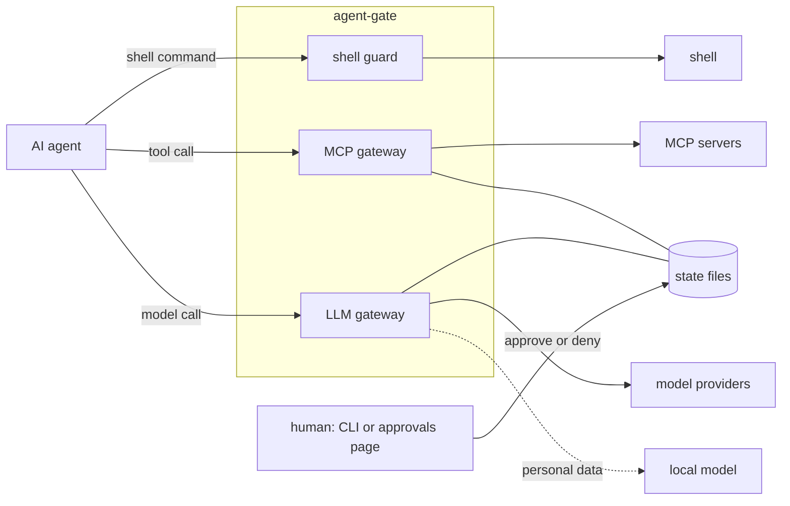

# agent-gate

Guards between an AI agent and its actions. Each guard decides in code, before the action runs.

[](https://github.com/bobbyhin/agent-gate/actions/workflows/ci.yml)

## Features

### Shell guard

A Claude Code hook: Claude Code runs it before every shell command.

- **Four decisions** - pass, warn, ask a human, or block
- **Reads like a shell** - quotes, heredocs, wrappers and `sh -c`
- **Upload check** - blocks secret files; asks before other uploads
- **No model, no network** - same input, same answer, in milliseconds
- **Red-team cases** - 239 commands, each with its expected decision

### MCP gateway

MCP is the protocol agents use to call tools. The gateway sits between the agent and its MCP servers.

- **Policy** - allow, warn, ask or block each tool call
- **Approvals** - a human's one-time yes for one exact call
- **Approvals page** - a local web page on 127.0.0.1
- **Audit log** - a line before every call; hashes, not values
- **Pinned tools** - a changed tool definition is withheld
- **Result guard** - optional; withholds secrets, flags instruction-like text

### LLM gateway

An OpenAI-compatible endpoint between the agent and its model providers.

- **Routing** - picks the model; retries, then falls back
- **Budget caps** - daily and monthly dollar caps per key
- **Leak guard** - blocks or redacts secrets in prompts and answers
- **Local model** - calls with personal data can stay local
- **Held streams** - streamed answers are read before release, by default
- **Usage log and metrics** - a line per call, trace ids, Prometheus

## Quick Start

### 1. Clone and install

Needs Node 20 or newer.

```
git clone https://github.com/bobbyhin/agent-gate.git
cd agent-gate
npm install
```

### 2. Run the tests

`npm test` compiles the TypeScript, then runs every suite with `node --test`.

```
npm test
```

### 3. Use the shell guard as a Claude Code hook

Add this to `.claude/settings.json` (or `~/.claude/settings.json`). Replace `/path/to/agent-gate` with the real path.

```json
{
  "hooks": {
    "PreToolUse": [
      {
        "matcher": "Bash",
        "hooks": [
          {
            "type": "command",
            "command": "node /path/to/agent-gate/bin/claude-pretooluse-hook.js"
          }
        ]
      }
    ]
  }
}
```

To try the hook without Claude Code, see [the hook section](docs/shell-guard.md#use-it-as-a-claude-code-hook).
The gateways have their own setup steps: [MCP gateway](docs/mcp-gateway.md#set-it-up), [LLM gateway](docs/llm-gateway.md#set-it-up).

## How it works

An agent can run shell commands, call tools and call models. agent-gate puts a guard in front of each one.



- A call that needs a human waits in the approval queue. The queue is a state file kept out of the agent's reach.
- A human answers at the CLI, or on the approvals page.
- The agent learns the answer when it makes the same call again.

### The four decisions

| Decision | What happens | Example |
| --- | --- | --- |
| pass | The command runs. | `git status` |
| warn | A note goes to stderr, and the command runs. | `kill -9 4242` |
| ask | A human is asked to confirm first. | `git push origin main` |
| block | The command is refused (exit code 2). | `rm -rf ~` |

### The four red lines

These actions should always involve a human. They are hard to undo, or they leave the machine.

1. Spending money
2. Posting publicly to a real account
3. `git push`, merge, pull request, deploy, publish
4. Permanently deleting or overwriting something the agent did not create

The shell guard enforces lines 3 and 4. The MCP gateway's example policy has a rule for each of the four.

## Why it asks instead of blocking

- The first version blocked dangerous commands outright.
- In 46 days of the author's logs, it blocked 33 times.
- About 32 of those were legitimate work. None stopped a real disaster.
- So most rules now ask a human instead of blocking.

## Known limits

- It is a heuristic reader of shell commands. It is not a sandbox, and not a full shell parser.
- Aliases, variables, scripts run later and code that calls a shell itself get past it.
- Spending and posting usually go through APIs, MCP tools or a browser. The shell guard alone cannot enforce red lines 1 and 2.
- On 163 held-out red-team commands, it stops 8 of the 122 it should. Most misses are actions it does not check.
- Nothing has been deployed to a real cloud. The deploy files are only checked, locally and in CI.

The full lists: [shell guard](docs/shell-guard.md#known-limits), [MCP gateway](docs/mcp-gateway.md#what-the-gateway-does-not-cover), [LLM gateway](docs/llm-gateway.md#what-the-llm-gateway-does-not-cover).

## Project Structure

```
bin/                   the Claude Code hook and the agent-gate CLI
src/command-guard.js   the shell analyzer: analyze(command) -> { action, label, why }
src/gateway/           the MCP gateway: policy, approvals, audit log
src/llm/               the LLM gateway: routing, budgets, leak guard
test/                  the shell cases and the gateway test suites
examples/              a status server and a change review
docs/                  the manual, design records and demo pages
deploy/                Compose, Kubernetes and Cloud Run files (checked, not deployed)
```

## Docs

| File | What is inside |
| --- | --- |
| [docs/shell-guard.md](docs/shell-guard.md) | How the shell guard reads a command, its limits, the hook, red-team history, origin |
| [docs/mcp-gateway.md](docs/mcp-gateway.md) | MCP gateway: setup, approvals, policy, audit log, tool results |
| [docs/llm-gateway.md](docs/llm-gateway.md) | LLM gateway: setup, routing, budgets, leak guard, streaming, metrics |
| [docs/examples.md](docs/examples.md) | A status server behind the MCP gateway; a change review as a workflow |
| [docs/operations.md](docs/operations.md) | Failure behavior, performance numbers, deploy |
| [docs/development.md](docs/development.md) | What the tests check; the repository layout |
| [docs/related-work.md](docs/related-work.md) | Docker MCP Gateway, LiteLLM, Google's agent platform; how other tools bind a human's yes |
| [docs/red-team.md](docs/red-team.md) | The shell test cases, by category |
| [docs/exploring-the-codebase.md](docs/exploring-the-codebase.md) | Trace one decision to its code and tests |
| [docs/adr/](docs/adr/) | 14 design records (ADRs): why it works this way |
| [docs/demo/index.html](docs/demo/index.html) | A step-through replay of a real MCP gateway run |
| [docs/demo/llm.html](docs/demo/llm.html) | The same for the LLM gateway |
| [docs/demo/approvals.html](docs/demo/approvals.html) | The approvals page, read-only, with a recorded run |

The demo pages are static files: open them in a browser.

## Status

- v0.1.0: extracted from the guard that runs daily on the author's own agent setup. A newer private copy is in use there.
- `npm test` runs 1,368 tests, including the 239 red-team regression cases.

## License

MIT. See [LICENSE](LICENSE).
