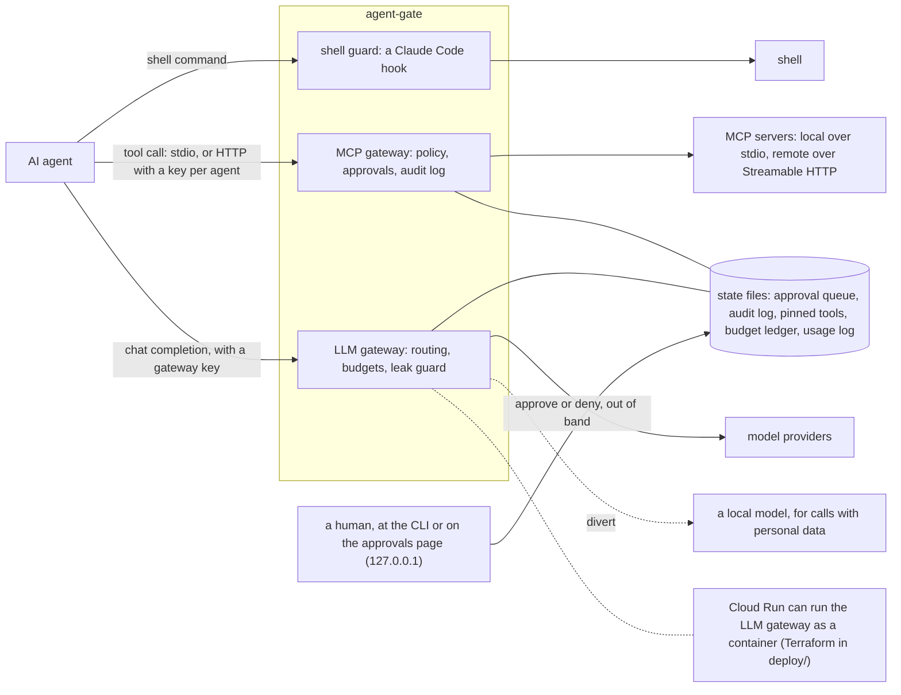

# agent-gate

Guards between an AI agent and its actions: a shell command guard, an MCP gateway that holds risky
tool calls for a human, and an LLM gateway with routing, budget caps and a leak guard. Each one
decides in code, before the action runs.

A call held for a human waits in the approval queue, a state file kept out of the agent's reach, and a
human answers it at the CLI, or on the approvals page, a local web page with the same checks; the
agent learns the answer when it makes the same call again. Two pages replay real runs step by step,
with the lines of code that decided each step: [the MCP gateway](docs/demo/index.html) and
[the LLM gateway](docs/demo/llm.html); a third is [the approvals page](docs/demo/approvals.html) itself,
read-only, with a recorded run (static files: open them in a browser).

The shell guard came first. Before the agent runs a shell command, it reads the command and decides
one of four things: **pass**, **warn**, **ask** a human, or **block**. The MCP gateway brings the same
decisions to tool calls; the LLM gateway decides which model serves a call, whether the caller's
budget allows it, and what may leave the machine.

This repository has five parts:

- `src/command-guard.js`: the analyzer. One function, no dependencies. `analyze(command)`
  returns `{ action, label, why }`.
- `bin/claude-pretooluse-hook.js`: a Claude Code `PreToolUse` hook built on the analyzer.
- `test/cases.json`: 239 commands, each with the decision it must get. They come from red-team
  rounds against earlier versions of the analyzer. A second suite, `test/cases-exfil.json`, holds
  73 uploads of local files (suite G, added with v5.1). A third, `test/cases-heldout.json`, holds
  163 commands from a later red team that the analyzer was never tuned on (`npm run redteam`).
- `src/gateway/`: an MCP gateway (TypeScript) that brings the same four decisions to MCP tool
  calls and holds risky calls until a human approves them; a call that cannot be undone is confirmed
  with an action token the agent never sees. See [MCP gateway](docs/mcp-gateway.md).
- `src/llm/`: an LLM gateway (TypeScript) in front of model providers, with routing, daily and
  monthly budget caps per key, stop rules for loops (a run ships, runs out of budget, or stops on a
  flat line, under caps the agent cannot raise), a leak guard for secrets and personal numbers in
  prompts and answers (streamed ones too), and a way to keep calls with personal data on a local
  model. See [LLM gateway](docs/llm-gateway.md).

The LLM gateway also comes as a container image, with Kubernetes manifests and Terraform for Google
Cloud Run. See [Deploy](docs/operations.md#deploy).

Status: v0.1.0. It is extracted from the guard that runs daily on the author's own agent setup,
where a newer private copy is in use. It is a heuristic reader of shell commands, not a sandbox.
See [Known limits](docs/shell-guard.md#known-limits).

## Documentation

The reference sections now live in `docs/`:

- [docs/shell-guard.md](docs/shell-guard.md): the shell guard, its limits, its red-team history and its origin
- [docs/mcp-gateway.md](docs/mcp-gateway.md): the MCP gateway
- [docs/llm-gateway.md](docs/llm-gateway.md): the LLM gateway
- [docs/examples.md](docs/examples.md): a status server behind the MCP gateway, and a change review as a workflow
- [docs/operations.md](docs/operations.md): failure behavior, performance and deploy
- [docs/development.md](docs/development.md): the tests and the repository layout
- [docs/related-work.md](docs/related-work.md): related work

## License

MIT. See [LICENSE](LICENSE).
