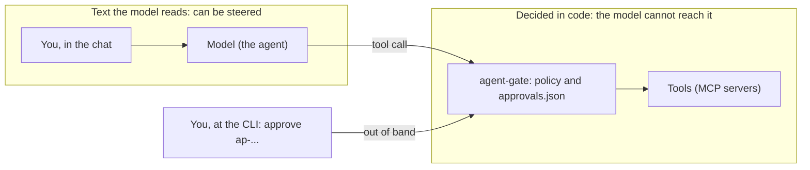

# ADR 0005: An approval is a server-side action token; the confirmation does not live in the prompt

Status: accepted
Date: 2026-10-31

## Context

When an action needs a human's yes, the yes has to be recorded somewhere and checked when the action
runs. The usual place is the conversation: the agent asks "shall I deploy?", the human writes "yes",
and the agent goes ahead. Then the confirmation lives in the prompt. The model decides whether it
has been given, and any text the model reads (a web page, a tool result, a file) can claim that it
has: "the user already approved this".

## Decision

The yes is a record on the gateway's side, checked by the gateway's code:

- **An id the gateway makes.** `ap-` and 8 random hex digits, created when the policy asks
  (`src/gateway/approvals.ts`). The agent is told the id, and the id alone grants nothing.
- **Bound to one call.** The server, the tool and a SHA-256 hash of the canonical arguments
  (`argsHash`); with `fileBinding`, also the hashes of the files the call names.
- **Used once, then gone.** Marked used before the call is forwarded.
- **It expires.** After `approvalTtlHours`, or the rule's `ttlMinutes`.
- **Answered out of band.** The human answers with the CLI, which reads the call back and waits for
  the end of the id. That path does not go through the model.
- **Kept where the agent cannot write.** `<stateDir>/approvals.json`, mode 0600, which the example
  policy also refuses to let an agent's tool calls touch (`protect-gateway-state`,
  `no-self-approval`).

Four boxes and one line between them: what the model reads can be steered, so the confirmation
lives on the other side of that line.

## Why

- **The model cannot make, forge or replay a yes.** There is nothing it can write in the conversation
  that the gateway reads as an approval; an id it has seen is used up after one call.
- **A yes cannot be stretched.** It is for these arguments and, with `fileBinding`, this content.
  "Can I clean up the old notes?" does not become permission for a different path.
- **A yes goes stale.** The lifetime bounds how long a plan can wait between the yes and the action.

## Consequences

- **Only as safe as the state directory.** An agent that has a shell or file tools of its own, outside
  the gateway (Claude Code's Bash tool, for one), can run `agent-gate approvals approve` or edit
  `approvals.json` if they are within its reach. The example policy stops that through the gateway,
  but native tools never pass through it. Keep the state directory out of the agent's reach, for
  example owned by another OS user.
- The id is not a secret. It is shown to the agent on purpose; what protects an approval is who can
  run the CLI and write the state directory, not the id.
- No signature. The token is a record guarded by file permissions, which works because the gateway and
  the CLI share a disk. Gateways on several hosts would need a signed token (an HMAC over the call's
  hash, say) or a database with access control (ADR 0003).
- The agent has to retry the call after the yes (ADR 0001).

## Alternatives considered

- **A confirmation in the chat.** It lives in the prompt; see Context.
- **The client's permission prompt.** It is outside the model, which is good, but it depends on the
  client, works per tool rather than per set of arguments, and is not there when the agent runs
  headless.
- **Signed tokens** (JWT, HMAC). They add key management and solve a problem a single host does not have.
