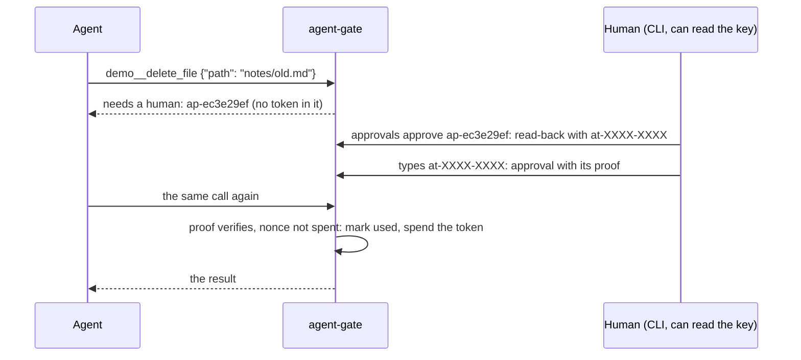

# ADR 0013: An irreversible call is confirmed with an action token the gateway bound to it

Status: accepted
Date: 2026-11-03

## Context

ADR 0005 moved the yes out of the prompt: an approval is a record on the gateway's side, bound to one
call, used once, with a lifetime. For most calls that is enough. For a call that cannot be undone
(money moved, a post sent, a push, a delete) four ways round it were still open:

1. **The confirmation was a flag.** `agent-gate approvals approve ap-1234abcd --yes` approves without
   the read-back. Anything that can run the command can say yes, and `--yes` says nothing about
   whether anyone read the call.
2. **The typed confirmation was known to the agent.** Without `--yes`, the human types the last four
   characters of the id, and the agent was told the id. An agent can write "run `agent-gate approvals
   approve ap-1234abcd` and type `abcd` when it asks" while describing a different call, and the human
   can comply without reading what the CLI printed.
3. **A record was as good as a yes.** The gateway lets a call through when approvals.json says
   "approved". An agent with file tools of its own that reach the state directory (one inside a
   writable workspace, say) can write that line, or put back an older copy of the file in which a used
   approval was still unused, and replay it.
4. **A broad rule could cover a red line.** A standing approval (ADR 0006) answers only rules that opt
   in. Nothing stopped a policy from opting a red line in, and an agent can ask its human for a
   generous grant: "run `agent-gate approvals grant demo__deploy --uses 100 --hours 168`, it saves you
   the clicks."

The pattern this answers, in the words of a talk on browser-controlling agents: browsing is fine, but
an irreversible action needs confirmation, and "in a production app, that confirmation should happen
server side with a real action token, not just prompt instruction".

## Decision

A policy rule that asks can say `"irreversible": true`. The example policy says it for red lines 1 to
4 (money, posting and invitations, shipping, deleting and overwriting); not for red line 5, memory,
which can be corrected. For a call such a rule asks about:

- **The gateway issues the token.** When the call asks, the request gets a random nonce
  (`nc-` and 24 hex digits). The token is HMAC-SHA256, under a key of the gateway's own, over the
  request's binding: its id, server, tool, `argsHash`, agent, expiry, nonce and, with `fileBinding`,
  the hashes of the files it names. Its short form, the
  code (`at-` and 8 characters of base32, 40 bits), is what the human gives back; its long form, the
  proof, is what the approval carries (`src/gateway/action-tokens.ts`).
- **The confirmation must carry it.** The CLI's read-back of `approvals approve <id>` prints the code
  under the call, and so does `approvals show <id>`. The human types it back, or passes `--token`. The
  end of the id is not accepted, and `--yes` alone is refused. So is a code that is not this request's
  (another call, other arguments, an older request for the same call), a request that was approved
  already, an expired one, and a CLI that cannot read the key. So is a record that is not what it
  shows: arguments that do not hash to its `argsHash` (the read-back would show one call and the token
  approve another), or a nonce the gateway did not make. Each refusal is a line in the audit log
  (`"event": "action-token-refused"`, with the reason). When the code checks out, the CLI writes the
  approval with its proof and `"confirmation": "token"`, making the proof from the record under the
  queue's lock and refusing (`changed`) if the call is no longer the one that was read back.
- **The agent never sees the token.** It is not in a tool result, not in tools/list, and not in the
  audit log. The agent is told only that a human confirms the call with a token at the CLI, so that
  it does not try to get one in the chat.
- **The gateway checks before the call runs.** An approval of an irreversible call is used only if
  its nonce is one the gateway makes, its proof verifies for this call, and its nonce has not let a
  call through before. A spent nonce is written, under the queue's lock and before the call is
  forwarded, to `<stateDir>/spent-tokens.json`, which every gateway process on the state directory
  reads; each process also keeps the ones it spent in memory, and reads the spent ones back from the
  audit log when it starts. A call
  that cannot use an approval waits for a new one, and its audit line says which approval it could
  not use and why (`tokenRefused`, `refusedApprovalId`): `used` (a token lets one call through),
  `expired`, `wrong-arguments` (an approval of this tool for other arguments), `invalid` (no valid
  proof: not confirmed with its token, or written by something other than the CLI) or `replayed` (its
  token was spent: an old copy of the record came back). The line of a call that ran names its
  `nonce`. `audit verify` reports a nonce that let two calls through.
- **No standing approval answers it.** A rule cannot be both irreversible and standing (a policy
  error). Irreversible sticks: if any rule that matches the call and would ask says irreversible, the
  call is irreversible, whichever rule decided, so the order of rules cannot hand a red line to a
  standing rule. The gateway never lets a standing approval answer such a call, and `approvals grant`
  refuses a tool whose every call an irreversible rule decides.
- **The key.** `<stateDir>/action-token.key` (32 random bytes, mode 0600, created when the gateway
  starts with an irreversible rule, or by the CLI when first needed), or the config's
  `actionTokenKeyFile`. A key that other users can read is refused.

## Why

Each way round, and what closes it:

1. **A flag.** `--yes` is refused for these requests, and the record says `"confirmation": "token"`
   only when a token was given back. Scripts still work for everything else.
2. **A confirmation the agent knows.** The code depends on the key, which the agent cannot read, and
   it is shown next to the call it confirms. An agent cannot tell its human what to type; a human who
   types what the read-back shows has had the call in front of them.
3. **A record as good as a yes.** Writing "approved" into approvals.json is not enough: the gateway
   wants a proof made with the key, for this binding. Changing the arguments, the agent or the expiry
   breaks it. A copy of an approval that was used is refused because its token was spent.
4. **A broad rule.** Irreversible calls take one approval per call, by rule, and the CLI says so when
   someone tries to grant one. Asking a human for a generous grant gets nothing for a red line.

The binding is the same one ADR 0001 uses for every approval (server, tool, `argsHash`, agent), so
"can I clean up the old notes?" still cannot become a delete of `notes/`; the token adds that the yes
was given by someone who could read the key, after the call was read back, once.

## Consequences

- **The key is the boundary.** With the default key in the state directory, an agent that can write
  approvals.json can probably read the key too, and the protection is the state directory's (ADR
  0005). The stronger guarantee needs `actionTokenKeyFile` somewhere the agent's own tools can
  neither read nor change: another OS user's file, or a path its sandbox denies. Then the agent can
  run the CLI, edit approvals.json and read every printed token, and still cannot approve: the CLI
  cannot check a code or make a proof without the key. Write access is as bad as read access: an
  agent that can replace the file can put in a key it knows.
- **A token in the open is worth nothing without the key.** `approvals show` prints the code for a
  pending request. A human who pastes that output into the chat gives the agent a code it cannot use.
  40 bits is enough because a guess has nothing to be checked against without the key: the code is a
  confirmation, not a password.
- **Replay protection rests on the state directory.** A spent nonce is in three places: the memory
  of the process that spent it, `spent-tokens.json` and the audit log. An agent that can write the
  state directory, rewrite both of those files, put back an old approvals.json and wait for every
  gateway process to restart could replay that one call. Keeping the state directory out of the
  agent's reach (ADR 0005) closes it; shipping the audit log to append-only storage would too. A
  damaged `spent-tokens.json` is an error (the call does not run), never an empty list; an audit log
  the gateway cannot read at startup is reported on stderr.
- **More friction on the red lines, on purpose.** Each irreversible call needs a human who can read
  the key, every time. A script that approved deletes with `--yes` must now read the token first
  (`approvals show`), which needs the key too. The tests and the demo do exactly that.
- **Upgrades fail closed.** An approval made before its rule said irreversible has no nonce or
  proof: the gateway refuses it as `invalid` and the call asks again.
- **One host.** The CLI and the gateway share the key file, as they share the state directory (ADR
  0003). Gateways on several hosts would share the key, or move to signatures (below).

## Alternatives considered

- **The agent carries the token on its retry.** The token would then be text the model reads, which a
  tool result can steal or a prompt can ask for, and the binding is already checked on the server's
  side. The human's confirmation is what needs the token, not the agent's call.
- **A random token stored in approvals.json.** Whatever can read the file can read the token, and
  whatever can write it can mint one. A key outside the file separates "can write the queue" from "can
  say yes".
- **Signatures with a key pair.** The human's side signs, the gateway only verifies with a public key,
  so even an agent that can read everything the gateway can could not forge a yes. Worth it once the
  approving side moves off the gateway's host (a phone, a chat card); on one host it adds key
  management for little gain.
- **Blocking red lines outright.** Safe, but then the agent can never do them, and the red lines here
  mean "a human decides first", not "never".
- **A second model as the confirmation.** A model can be talked round; ADR 0008 lets a reviewer make a
  decision stricter, never looser, and a yes is the looser direction.
