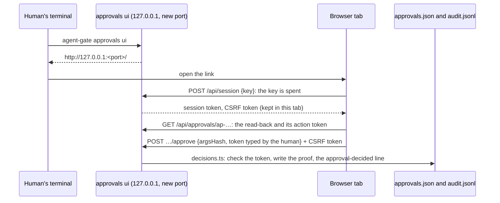

# ADR 0014: The approvals page is a separate local process, and its link is the key

Status: accepted
Date: 2026-11-03

## Context

A human answers approval requests at the CLI (ADR 0001, 0005): `approvals list`, then `approvals
approve <id>`, which reads the call back and waits for the end of its id, or for an irreversible call
its action token (ADR 0013). That works, and it is a terminal's shape: one request at a time, long
arguments wrapped, a token copied from one line into the next. A page shows the queue at a glance and
each read-back in full, next to the token it asks for. It is also a demo that people can open.

A web page opens ways round the gate that the CLI does not have:

1. **A port on 127.0.0.1 is reachable by every process on the machine,** an agent's own HTTP or shell
   tool included. Loopback is not authentication.
2. **The browser can be steered by other sites.** A page the human has open elsewhere can make the
   browser send requests to 127.0.0.1 (cross-site request forgery), or get a name it controls to
   resolve to 127.0.0.1 and then read the answers (DNS rebinding).
3. **Cookies are not scoped to a port.** A cookie set by one port of 127.0.0.1 is sent to every port
   on 127.0.0.1, so a server an agent starts on another port receives it if the human opens a link to it.
4. **An origin outlives the process.** A browser keeps a service worker or a cached page per origin
   (`http://127.0.0.1:<port>`) after the server that left it is gone. If the page used the same port
   every time, an agent could hold that port while the page is not running, get the human to open it
   once ("here is a preview"), leave a service worker or a long-cached page behind, and be the page the
   next link opens: same origin, so it would pass every check below and take the session.
5. **The page shows text the agent wrote:** every argument of every request. Rendered as HTML it can
   run script in the page that holds the session (cross-site scripting); rendered as text it can still
   lie, with a right-to-left override that shows `exe.txt` as `txt.exe`.
6. **A page invites shortcuts:** an approve button that does not need the token, a token filled in
   for the human, a "grant for an hour" button.

## Decision

`agent-gate approvals ui [--port <n>]` serves the approvals page: `src/gateway/approvals-ui.ts` (the
server, Node's `http` module, no framework and no new dependency) and `src/gateway/approvals-page.ts`
(one HTML document, its script and style inline).

- **A separate process, started by the human in their own terminal,** like the CLI, on the same
  config and state directory. It is not part of `serve`: the stdio gateway is started by the agent's
  client, which can read its output, and the HTTP gateway's port is the agents' port.
- **127.0.0.1 only, on a new port every start.** There is no option for another address. Without
  `--port` the system picks a free port, so the page's origin is one of thousands, and anything left in
  the browser for it would have had to be prepared for that port in advance. `--port <n>` fixes the
  port for whoever needs it, and the banner then says what that costs, before the link. agent-gate
  registers no service worker: if one controls the page, the page removes it and stops, using neither
  the link nor a kept session. Every request's `Host` header must be one of the listener's own names
  (the check of `serve --http`), so a rebound name gets 403.
- **The link is the key.** At start it prints, once, to that terminal, a link with a launch key (32
  random bytes) in its fragment: `http://127.0.0.1:<port>/#key=…`. A browser never sends a fragment to
  a server. The page takes the key out of the address bar and trades it, once, for a session: a
  session token and a CSRF token (32 random bytes each), kept in the tab's `sessionStorage` (scoped
  to this host and port) and sent as headers. No cookies. A second trade of the key is refused, so a
  copy of the link found later (history, scrollback) opens nothing; a wrong key does not spend it.
  One session per start. It ends after 60 minutes without a request from the human; the page's
  background polls (`x-agent-gate-poll: 1`) are checked but do not count. Then the page is started again.
- **Every request is checked before it reaches the queue.** API calls need the session token
  (`Authorization: Bearer`) and, when the browser sends `Sec-Fetch-Site`, `same-origin`. A request that
  changes anything also needs the session's CSRF token (`x-agent-gate-csrf`), an `Origin` that is the
  page's own (a missing one is refused), a JSON body (`application/json`, which no form can send) of at
  most 16 KiB. Refusals are printed in the terminal; the audit log is for decisions.
- **The CLI's decisions, through the CLI's code.** Approve and deny call `src/gateway/decisions.ts`,
  which the CLI calls too: the same record in approvals.json, the same `approval-decided` line, and
  for an irreversible request the same checks in the same order, each refusal the same
  `action-token-refused` line (`no-token`, `mismatch`, `used`, `expired`, `no-key`, `changed`). The
  page also sends the `argsHash` of the call it read back. An irreversible approval is checked for it
  after the CLI's own checks (a pending request with other arguments is a `changed` refusal); any
  other decision is checked for it while the request can still be decided (a pending request, and for
  a denial also an approval not used yet), and otherwise refused as the CLI refuses it.
- **The confirmation is the CLI's.** The read-back is the CLI's read-back, word for word. A request
  from an irreversible rule needs its action token, which the read-back shows under the call: only in
  that answer, to the session, never in the list, the audit log or the terminal. The field starts
  empty, the page never fills it, and the server checks what was typed; Approve with an empty field is
  a yes without the token, refused as `no-token`. Any other request needs the last four characters of
  its id (`"confirmation": "typed"`). There is no `--yes`.
- **No standing approvals made here.** The page lists those in force, read-only. Granting and revoking
  stay at the CLI, and no standing approval ever answers an irreversible call (ADR 0013).
- **What the agent sent is text.** The page builds every element with `createTextNode`, never HTML,
  and shows control, invisible and direction-changing characters as `\uXXXX` (`HIDDEN_CHARS`). The
  server escapes the same characters, and line breaks, in everything it prints to the terminal. The
  page's Content-Security-Policy allows its own script and style by hash, connections to itself, and
  nothing else (`default-src 'none'`, `frame-ancestors 'none'`, no forms, no base URL).
- **The example policy keeps an agent from starting it through the gateway.** Its `no-self-approval`
  rule blocks `approvals ui` from a shell tool, next to `approve`, `deny` and `grant`: whoever starts the
  page reads its link. It is a regex on the command's text, with that rule's limit (below).
- **The demo is the same page.** `scripts/demo-approvals.js` records a real run (the gateway with the
  example policy and the fake server, the page's requests over HTTP, the agent's retries, `audit
  verify`) into `docs/demo/approvals.html`, the page in its demo mode: no server, a policy that allows
  no connection at all, every control disabled, and the link's key and the session and CSRF tokens left
  out. `test/demo-approvals.test.js` fails unless the file is exactly what the page's code writes now.

## Why

Each way round, and what closes it:

1. **A reachable port.** A process that never saw the link has no key and gets 401 for everything.
   The key is printed once, to the terminal of the human who started the page, and spent by the first
   trade.
2. **A steered browser.** A forged request carries another site's `Origin` (or a `Sec-Fetch-Site`
   that is not `same-origin`), cannot send JSON without a preflight this server never answers, and
   cannot know the session or CSRF token, which no cookie carries. A rebound name fails the `Host`
   check before anything else.
3. **Shared cookies.** There are none. The session lives in one tab's storage, which other ports
   cannot read, and goes out only in headers that this page's script sets.
4. **An old origin.** Each start is an origin picked from thousands of ports. To be waiting there,
   something would have had to prepare that port in advance, or every port of the range (see
   Consequences). A service worker that does control the page makes it stop before it uses the link.
   While the page runs, nothing else can hold its port.
5. **The agent's text.** It is never parsed as HTML, the policy would not run an injected script
   anyway, and the escapes show the characters a screen would hide, on the page and in the terminal.
6. **Shortcuts.** The page asks for exactly what the CLI asks for, and the server decides with the
   CLI's code, so the page cannot be looser than the CLI. It holds nothing the CLI does not for the one
   who opens it through its link, the human who started it and could already run `agent-gate approvals`
   as that user; and a page that cannot read the action-token key cannot approve an irreversible call
   (`no-key`), exactly like the CLI. The ways in that need no link (a browser an agent drives, an origin
   prepared in advance) are under Consequences.

## Consequences

- **One tab per start.** Another tab, or the same tab after 60 minutes without a request from the
  human, needs a new link: restart `approvals ui`. On purpose: a session that outlives its use is a
  session to steal. A link pasted into a tab that is already open works there.
- **The terminal holds the key.** An agent that can read the human's terminal, or that starts the
  page through a shell of its own outside the gateway, can open the session, as it could run the CLI.
  Keeping the CLI and the state directory out of the agent's reach (README, "What the gateway does not
  cover") is what stops it. The example policy's rule stops the plain command through the gateway, but
  it reads text: a quoted or assembled word (`agent-gate approvals 'ui'`) gets past it, as it gets past
  the same rule for `approve` (the tests record this). For irreversible calls the key file is still the
  boundary (ADR 0013).
- **A browser an agent drives can read the page.** The token is on the screen, as it is in the
  terminal for the CLI. An agent whose browser tool is attached to the human's own browser (an
  extension, or a remote debugging port) can read the page, the token included, and with typing and
  clicking allowed it could fill the field in itself; the page's policy does not bind a debugging
  protocol. Open the page in a browser, or a browser profile, that no agent tool drives. The example
  policy lets `browser-input` take a standing approval (ADR 0006): a grant for typing and clicking in
  a browser the page is open in would answer, in effect, what only a token should.
- **A new port raises the cost; it does not close the old-origin way round.** The system picks from
  a range of thousands of ports and reuses them. An agent with a page kept open in the human's browser
  could go through the range, holding each port in turn and loading it in a frame of its own page,
  and leave a service worker for each, which a later visit to that port would meet. The page notices a
  worker that lets it run (it stops), not a page that a worker fakes in full. Keep pages that an agent
  serves out of the browser you approve in.
- **A fixed `--port` gives up even that.** Its origin is the same every start, so one prepared port
  is enough; the banner says so, before the link.
- **The audit line does not say which door.** A decision made on the page writes the CLI's line,
  `decidedBy` the OS user who started the page. A field for the door could be added later; `audit
  verify` and `approvals stats` would not need to change.
- **This machine only, plain HTTP.** Approving from a phone or a chat card is the open question of ADR
  0012; signatures (ADR 0013, alternatives) fit it better than a page served over the network.
- **The page polls** the queue every 5 seconds while it is visible, reading approvals.json without the
  lock, as `approvals list` does.
- **A browser that sends no `Origin` on a POST is refused.** Current browsers send it; failing closed
  is the safe side.
- **The demo has to be recorded again** (`npm run demo:approvals`) after any change to the page's
  code; the test says so.

## Alternatives considered

- **FastAPI and React,** as first planned. A second runtime and a build step for one page; Python
  would re-implement the queue's locks and the token checks or shell out to the CLI, and a bundle
  makes hashing the page's script for the policy, and a self-contained demo, harder.
- **Inside the gateway** (`serve`, or a route on `serve --http`). The stdio gateway belongs to the
  agent's client, which reads its output: a printed link would go to the agent. The HTTP gateway's
  port is the agents' port, so the human's yes would be one header away from them.
- **A fixed default port,** easy to bookmark. It keeps one origin for every start, which is the
  old-origin way round; the link works once anyway, so a bookmark would not open the page.
- **A cookie session** (`HttpOnly`, `SameSite=Strict`). Same-site is not same-port: a server on another
  port of 127.0.0.1 receives the cookie.
- **No authentication beyond loopback,** as many local dashboards do. Then any process on the machine
  could approve.
- **A link or password that keeps working.** A copy in the browser's history would open the page for
  as long as the process runs.
- **Keeping the token out of the page** (the human reads it in `approvals show`). Then the page cannot
  approve what matters most. What makes the token a confirmation still holds here: the agent cannot
  know it, and the human reads it next to the call it confirms.
- **A one-click approve, or a token filled in for the human.** Then the token would confirm nothing.
