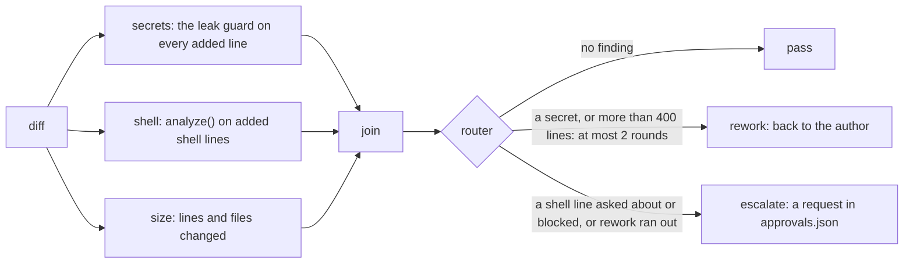

Back to the [README](../README.md)

# Examples

## Example: a status server behind the MCP gateway

`examples/status-mcp/server.js` is a small, real MCP server (plain Node on the official SDK) to put
behind the gateway in place of the tests' fake. It reads a status folder, `sample-status/` (the
service-level objectives of some scheduled jobs, when each job last ran, an inbox of notices), and
answers with structured JSON, so an agent reads a few fields instead of long log files:

| Tool | Kind | What it gives |
| --- | --- | --- |
| `slo_now` | read | each objective's target, actual value and whether it is met |
| `bot_status` | read | each job's last run, whether it went well, and whether it is overdue |
| `inbox_unread_count` | read | how many notices are unread, and the oldest one |
| `mark_inbox_read` | write | marks one notice read by id, or every notice with `"all": true` |

The server changes nothing unless it is started with `--writable`. `examples/status-mcp/policy.json`
lets the reads through, asks a human before a write, and blocks marking the whole inbox read at once;
`examples/status-mcp/gateway.config.json` puts the server and the policy together. From the
repository root, after `npm run build`:

```
node bin/agent-gate.js serve --config examples/status-mcp/gateway.config.json
```

A real run with that config, an MCP client making the calls and a human answering at the CLI (`>`
is a call and the text the agent got back):

```
> status__slo_now {}
{"window":"30d","objectives":[{"name":"jobs finish on time","target":0.99,"actual":0.994,"met":true},{"name":"jobs succeed","target":0.995,"actual":0.987,"met":false}]}
> status__inbox_unread_count {}
{"unread":2,"oldest":{"id":"n-101","subject":"A watched item dropped below its target price"}}
> status__mark_inbox_read {"id":"n-101"}
agent-gate: this call needs a human decision, so it was not run.
Reason: This changes the inbox, so a human says yes first. (rule inbox-writes)
Approval id: ap-26592ba2 (expires 2026-11-01T04:51:39.697Z)
A human can approve it with: agent-gate approvals approve ap-26592ba2
Once it is approved, make exactly the same call again (same tool, same arguments) and it will run once. Different arguments need a new approval.
Do not try to get the same result another way.   (isError)
$ agent-gate approvals approve ap-26592ba2 --yes
approved ap-26592ba2: status__mark_inbox_read {"id":"n-101"}
The agent can now make this exact call once, until 2026-11-01T04:51:39.697Z.

> status__mark_inbox_read {"id":"n-101"}
{"marked":0,"wouldMark":["n-101"],"note":"this server was started without --writable, so it changed nothing"}
> status__mark_inbox_read {"all":true}
agent-gate blocked this call, so it was not run: Marking the whole inbox read hides what nobody looked at; mark items one by one. (rule no-bulk-mark)
Blocked calls cannot be approved. Do not try to get the same result another way.   (isError)
```

The call lines it left in the audit log, with each line cut down to these fields:

```json
{"seq":1,"tool":"slo_now","decision":"allow","rule":"default","forwarded":true}
{"seq":2,"tool":"inbox_unread_count","decision":"allow","rule":"default","forwarded":true}
{"seq":3,"tool":"mark_inbox_read","decision":"ask","rule":"inbox-writes","forwarded":false,"approvalId":"ap-26592ba2"}
{"seq":4,"tool":"mark_inbox_read","decision":"ask","rule":"inbox-writes","forwarded":true,"approvalId":"ap-26592ba2"}
{"seq":5,"tool":"mark_inbox_read","decision":"block","rule":"no-bulk-mark","forwarded":false}
```

`test/status-mcp.test.js` runs the same steps on a writable copy of the folder: it checks that the
write ran once after the approval, that the bulk write never reached the server, and that
`audit verify` passes on the log.

## Example: a change review as a workflow

`examples/change-review/review.js` puts the guards together as the checks of a review: three
independent checks on a diff, a join, and a router that decides what happens next. An escalation
becomes a request in the same approval queue the MCP gateway uses.



A real run on the sample diff, which adds a release script that deploys:

```
$ node examples/change-review/review.js --state /tmp/review-state examples/change-review/sample.diff
round 1: escalate (a shell line crosses a red line: gcloud deploy)
  parse       0.06 ms
  secrets    13.68 ms
  shell      13.20 ms
  size        0.02 ms
  join        0.01 ms
  router      0.04 ms
queued for a human: ap-513a1e36
  agent-gate approvals approve ap-513a1e36
```

Each round of rework is the author's next version of the diff, given as the next file on the command
line. The checks are independent nodes; in this script they share one thread, so the graph shows the
structure, not a parallel speed-up. Shell lines are read from `*.sh` files, Dockerfile `RUN` lines,
single-line `run:` steps of GitHub workflows and Makefile recipes. `test/change-review.test.js` covers
each route, the rework limit and the queued request.
