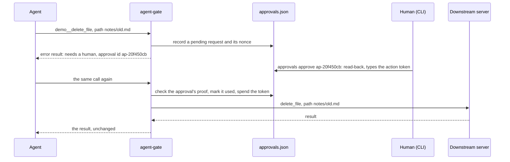
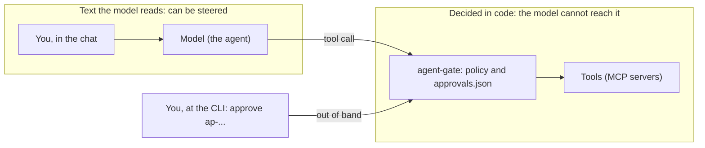

Back to the [README](../README.md)

# MCP gateway

The shell guard only sees shell commands. Spending money and posting usually happen through tools
instead: an MCP server for payments, email, chat or a code host. The MCP gateway is the layer for
those. It is an MCP server, over stdio for one agent or over Streamable HTTP for several (see
[Agents over HTTP](#agents-over-http)), that sits between the agent and one or more downstream MCP
servers: local ones that it starts over stdio, or remote ones that it reaches over Streamable HTTP.
The agent sees every downstream tool as `<server>__<tool>`, and before a call is forwarded, a
policy decides one of four things:

| Decision | What happens |
| --- | --- |
| allow | The call is forwarded. The downstream result comes back as it is, unless the optional result guard withholds or redacts it (see [Tool results are untrusted data](#tool-results-are-untrusted-data)). |
| warn | The same as allow, plus a note on the gateway's stderr. |
| ask | The call is not forwarded. A pending approval is recorded, and the agent gets an error result that names its id. A human answers it with the CLI. |
| block | The call is not forwarded and not queued. The agent gets an error result. |

A rule can also rewrite a call's arguments (cap a limit, force a dry run, drop or redact a field)
before one of these decides; see [Policy](#policy). Every decision is written to an audit log. The gateway is written in TypeScript on the official
MCP SDK (`@modelcontextprotocol/sdk`), which is its only runtime dependency besides `zod`.

Status: new. It is covered by the tests in [Run the tests](development.md#run-the-tests), but unlike the shell
guard it has not been used day to day yet.

To see it work without installing anything, open [docs/demo/index.html](demo/index.html) in a
browser: a replay of a real run, step by step (a call that runs, a call held for a human and
approved, a block, a prompt injection, the audit log checked), with the lines of code that decided
each step. `npm run demo` records it again from a live run; `test/demo.test.js` fails when a line it
quotes no longer matches the code. It is a static file with no server behind it, so it could be
published with GitHub Pages; this repository does not set that up.

## Set it up

```
npm install
npm run build
cp gateway.config.example.json gateway.config.json
```

`gateway.config.json` lists the downstream servers, the policy file and a directory for state:

```json
{
  "servers": [
    {
      "name": "demo",
      "command": "node",
      "args": ["dist/test/gateway/fake-downstream.js"]
    }
  ],
  "policy": "policy.example.json",
  "stateDir": ".agent-gate",
  "approvalTtlHours": 24
}
```

The example proxies the fake server from the end-to-end test. Its tools (`echo`, `delete_file`,
`run_command` and a few more) only pretend, so the whole flow can be tried safely; its path is
relative, so run the gateway from the repository root. For real use, list real servers, for
example `{ "name": "files", "command": "npx", "args": ["-y", "@modelcontextprotocol/server-filesystem", "/srv/agent-work"] }`.

- `name` becomes the tool prefix. It may use letters, digits, `-` and single `_`, never `__`.
- A remote server has `url` instead of `command`, for example
  `{ "name": "docs", "url": "https://mcp.example.com/mcp", "headersFromEnv": { "Authorization": "DOCS_MCP_AUTH" } }`.
  The gateway reaches it over Streamable HTTP. `headersFromEnv` maps each header to the environment
  variable that holds its value (here the whole `Bearer ...` string), so no token is ever in the
  config; a variable that is not set stops the gateway at startup, naming the variable. The URL must
  use `https://` unless the server is on this machine (`localhost`, `127.0.0.1`, `[::1]`), it may not
  carry credentials, and redirects are refused, so the header is never sent anywhere else. A header
  value that a server quotes back in an error is cut out of the gateway's log and of what the agent
  sees. Call lines in the audit log for such a server have `"transport": "http"`.
- `timeoutSeconds` (optional, per server, default 60) is how long one request to the server may take.
- `optional` (per server, default `false`): the gateway starts without this server when it cannot be
  started, and tries it again when it is needed. A server that is not optional and cannot be started
  stops the gateway. `maxRestarts` (per server, default 3, at most 10) is how many failed tries in a
  row to start a server again are made before it is given up. See
  [When a server goes away](#when-a-server-goes-away).
- `command` and `args` start the server. A server gets only a short list of safe environment
  variables (such as `PATH` and `HOME`), not the gateway's whole environment. Add an `env` object
  for the variables it needs.
- `policy` and `stateDir` are resolved against the config file's directory.
- `approvalTtlHours` (default 24) is how long a request stays open, unless the rule that asked sets
  its own `ttlMinutes`. `auditArguments` (default
  `false`) is explained under [Audit log](#audit-log).
- `actionTokenKeyFile` (optional, default `<stateDir>/action-token.key`) is the key behind the action
  tokens that confirm irreversible calls. Put it where the agent's own tools can neither read nor
  change it (another OS user's file, or a path its sandbox denies); the gateway and the human's CLI
  need to read it. See
  [Irreversible calls take an action token](#irreversible-calls-take-an-action-token).
- `expose` (optional, per server), for example `["read_*", "search_*"]`: globs of the tool names the
  agent may see and call; the others are hidden, and a call to one is blocked. `pinTools` (default
  `true`) pins each tool's definition the first time it is listed. See [Tool lists](#tool-lists).
- `resultGuard` (optional), for example `{ "leakPolicy": "llm-policy.example.json" }`: read what tools
  return, withhold or redact secrets in it, and flag text that reads like instructions. See
  [Tool results are untrusted data](#tool-results-are-untrusted-data).
- `fileBinding` (optional), for example `{ "roots": ["/srv/agent-work"], "arguments": ["path", "source"] }`,
  binds approvals to the content of the files that those arguments name. See
  [Approval rules](#approval-rules). Roots are resolved against the config file's directory and must exist.
- `profiles` (optional), for example `{ "read-only": { "demo": ["echo", "search_*"] } }`: named sets of
  tools. A connection started with `serve --profile read-only` sees and may call only the tools that
  its globs match, on the servers it names; a server it does not name shows it nothing. See
  [Tool lists](#tool-lists).
- `http` (optional): the agents that may connect over the network with `serve --http`, and where to
  listen. See [Agents over HTTP](#agents-over-http).

Then give the agent the gateway instead of the downstream servers. For Claude Code, in `.mcp.json`:

```json
{
  "mcpServers": {
    "gate": {
      "command": "node",
      "args": ["/path/to/agent-gate/bin/agent-gate.js", "serve", "--config", "/path/to/gateway.config.json"]
    }
  }
}
```

Some clients add their own prefix (Claude Code shows `mcp__gate__demo__delete_file`) and limit
the length of tool names, so keep server names short. To give an agent a narrower set of tools than
another, add `"--profile", "read-only"` to its `args` (one `serve` process serves one client). Over
stdio a profile holds only while the agent cannot change how its gateway is started (this file, or
the command); for a tier the agent cannot choose, use `serve --http`, where the profile belongs to
the agent's key.

## Agents over HTTP

`agent-gate serve --http` serves several agents from one process, over Streamable HTTP at `/mcp`. Each
agent has a key, and the config holds only the key's SHA-256; an agent may have a policy file and a
profile of its own. `gateway.config.http.example.json` has two:

```json
"http": {
  "listen": { "host": "127.0.0.1", "port": 8788 },
  "agents": [
    { "name": "builder", "sha256": "bbc627634c96ab790461fa070f7648a369a742d945812196fd84cc64d11b88ed" },
    { "name": "reader", "sha256": "367d765d57df060416a2e39dc82a405ece2ec7bed9add34f22739394cc572355", "profile": "read-only" }
  ]
}
```

Their keys are `demo-builder-key-not-a-secret` and `demo-reader-key-not-a-secret`. For a real agent,
make a key with `KEY="agk_$(openssl rand -hex 24)"`, give it to the agent, and put the output of
`printf %s "$KEY" | shasum -a 256` in the config; add `"policy": "<file>"` to give the agent a policy
other than the config's. A real run, from the repository root after `npm run build` (`Date` and
connection headers left out):

```
$ node bin/agent-gate.js serve --http --config gateway.config.http.example.json &
[agent-gate] listening on http://127.0.0.1:8788/mcp for 2 agent(s), as 127.0.0.1:8788, localhost:8788, [::1]:8788

$ export AGENT_KEY=demo-builder-key-not-a-secret
$ curl -s -i http://127.0.0.1:8788/mcp -H "Authorization: Bearer $AGENT_KEY" \
    -H "content-type: application/json" -H "accept: application/json, text/event-stream" \
    -d '{"jsonrpc":"2.0","id":1,"method":"initialize","params":{"protocolVersion":"2025-06-18","capabilities":{},"clientInfo":{"name":"curl","version":"1"}}}'
HTTP/1.1 200 OK
content-type: application/json
mcp-session-id: b017edba-61f0-4166-bd1c-08d27b878280
content-length: 165

{"result":{"protocolVersion":"2025-06-18","capabilities":{"tools":{"listChanged":true}},"serverInfo":{"name":"agent-gate","version":"0.2.0"}},"jsonrpc":"2.0","id":1}
```

After `notifications/initialized`, the builder calls `demo__delete_file` in that session and gets the
same answer as over stdio, `Approval id: ap-82e54b9f`. The human sees which agent asked:

```
$ node bin/agent-gate.js approvals list --config gateway.config.http.example.json
ap-82e54b9f  pending  demo__delete_file
  why:     Red line 4: this tool looks like it deletes or overwrites data. (rule red-line-4-delete)
  agent:   builder (its key; only its own call can use this approval)
  args:    {"path":"notes/old.md"}
  created: 2026-10-31T09:13:40.022Z  expires: 2026-11-01T09:13:40.022Z
```

Once it is approved, the builder's repeat runs (`pretended to delete notes/old.md`), and both call lines
say `"agent": "builder"`. A request without a key, and the reader's key with the builder's session id:

```
HTTP/1.1 401 Unauthorized
www-authenticate: Bearer realm="agent-gate-mcp"

{"jsonrpc":"2.0","error":{"code":-32000,"message":"agent-gate: missing or unknown agent key; send it as Authorization: Bearer <key>"},"id":null}

HTTP/1.1 404 Not Found

{"jsonrpc":"2.0","error":{"code":-32001,"message":"Session not found"},"id":null}
```

What holds for every agent:

- **Its key is its identity.** No key or an unknown one gets 401, and nothing is opened. Each MCP
  session gets its own `connId` (16 hex digits: one process opens many sessions, and the audit log
  keeps them all) and belongs to the agent that opened it: another agent's key gets 404 for its id,
  whatever the method (POST, GET or DELETE), the same answer as an id that does not exist.
- **Its own rules.** Calls are decided by the agent's policy, and it sees and may call only the tools
  of its profile, on top of each server's `expose`. Every call line names the agent.
- **Its own approvals and loop limits.** An approval is bound to the agent whose call asked for it:
  another agent's identical call is asked about anew. `approvals grant --agent <name>` makes a standing
  approval for one agent; without `--agent`, a grant covers only calls that come with no agent (stdio).
  `audit verify` fails a call that ran under another agent's approval or grant. Loop limits count each
  agent's calls on their own, so one agent cannot use up another's.
- **Its share of the process is bounded.** An agent keeps at most `http.maxSessionsPerAgent` sessions
  open (default 16): a new one closes that agent's least recently used, whose client then gets 404 and
  starts another. The gateway keeps at most `http.maxSessions` (default 256): past that, a new session
  gets 503 with `Retry-After`, and no agent's session is closed for another agent. A request body over
  4 MiB gets 413.
- **Only the gateway's own names.** The `Host` header, and the `Origin` header when there is one, must
  name the listener (its address as configured, and any loopback spelling of a loopback one) or one of
  `http.allowedHosts`, else 403. That stops a
  web page from reaching the listener through a browser (DNS rebinding). The listener binds 127.0.0.1
  unless `http.listen.host` says otherwise, and any other address needs `allowedHosts`.
- Plain HTTP with static keys, and no OAuth flow: for anything beyond this machine, put a TLS proxy in
  front. Sessions live in memory; a restart ends them, and one left idle for `http.sessionIdleMinutes`
  (default 60) is closed, on a timer and whenever a session opens. If the port is taken, the gateway
  stops its downstream servers and exits 1. Why it is built this way, and what deploying it would take:
  [ADR 0012](adr/0012-an-http-endpoint-for-agents.md).

## An approval, step by step



In a checkout, `agent-gate` is `node bin/agent-gate.js`. This is a real run with the example
policy and the fake server. The agent calls `demo__delete_file` with `{"path": "notes/old.md"}` and gets an error
result (`isError: true`) with this text:

```
agent-gate: this call needs a human decision, so it was not run.
Reason: Red line 4: this tool looks like it deletes or overwrites data. (rule red-line-4-delete)
Approval id: ap-20f450cb (expires 2026-11-04T10:03:40.315Z)
A human can approve it with: agent-gate approvals approve ap-20f450cb
This action cannot be undone: the human confirms it at the CLI with an action token that is never shown to you.
Once it is approved, make exactly the same call again (same tool, same arguments) and it will run once. Different arguments need a new approval.
Do not try to get the same result another way.
```

The human looks at the queue:

```
$ agent-gate approvals list
ap-20f450cb  pending  demo__delete_file
  why:     Red line 4: this tool looks like it deletes or overwrites data. (rule red-line-4-delete)
  token:   irreversible: approve it with its action token (the read-back of "approvals approve ap-20f450cb" shows it)
  args:    {"path":"notes/old.md"}
  created: 2026-11-03T10:03:40.315Z  expires: 2026-11-04T10:03:40.315Z
```

A delete cannot be undone, so its rule is irreversible (see
[Irreversible calls take an action token](#irreversible-calls-take-an-action-token)), and `--yes` is
refused:

```
$ agent-gate approvals approve ap-20f450cb --yes
agent-gate: ap-20f450cb is for an irreversible action (rule red-line-4-delete), so --yes is not enough: confirm it with its action token, typed after the read-back or passed with --token
```

`approve` reads the call back, with every argument in full, prints the request's action token under
it, and waits for the token. The human approves what they just read, and the agent, which was shown
the id but never the token, cannot tell them what to type:

```
$ agent-gate approvals approve ap-20f450cb
Approve this call? ap-20f450cb
  call:     demo__delete_file
  args:     {
              "path": "notes/old.md"
            }
  rule:     red-line-4-delete: Red line 4: this tool looks like it deletes or overwrites data.
  expires:  2026-11-04T10:03:40.315Z (in 1d 00h)
  token:    at-HVXW-4CA2
This cannot be undone. Type the action token (at-HVXW-4CA2) to approve it, anything else to stop: at-HVXW-4CA2

approved ap-20f450cb: demo__delete_file {"path":"notes/old.md"}
The agent can now make this exact call once, until 2026-11-04T10:03:40.315Z.
```

Anything else, or the end of the input, approves nothing (exit code 1). A wrong token, `--yes` alone,
and a request that was approved already are refused with an audit line of their own
(`"event": "action-token-refused"`, with the reason). `--token at-HVXW-4CA2` gives the token without the
prompt, for a human who read it in `approvals show`. With `fileBinding`, the read-back also lists each
bound file and says whether it still matches what the request saw. A request from a rule that is not
irreversible is read back the same way and waits for the last four characters of its id instead;
`--yes` skips that, for scripts.

The agent makes the same call again. This time it is forwarded, and the agent gets the downstream
server's result, `pretended to delete notes/old.md`. If it makes the call a third time, it is not
run, and it is told why:

```
agent-gate: the approval of this exact call (ap-20f450cb) was used already; an action token lets one call through, so this one was not run.
Reason: Red line 4: this tool looks like it deletes or overwrites data. (rule red-line-4-delete)
Approval id: ap-4bb9560f (expires 2026-11-04T10:03:40.753Z)
A human can approve it with: agent-gate approvals approve ap-4bb9560f
This action cannot be undone: the human confirms it at the CLI with an action token that is never shown to you.
Once it is approved, make exactly the same call again (same tool, same arguments) and it will run once. Different arguments need a new approval.
Do not try to get the same result another way.
```

Its audit line says the same: `"tokenRefused": "used"`, `"refusedApprovalId": "ap-20f450cb"`.

A denial can say why, so that the agent changes its plan instead of looking for another way
round. From a second run:

```
$ agent-gate approvals deny ap-22f08012 --reason "Keep it; move it to notes/archive/ instead."
denied ap-22f08012: demo__delete_file {"path":"notes/old.md"}
If the agent makes this call again, it is told that a human said no.
It is also shown your reason: "Keep it; move it to notes/archive/ instead."
```

The agent makes the same call again and gets:

```
agent-gate: a human denied this exact call (approval ap-22f08012, 2026-10-30T22:13:09.393Z), so it was not run.
The human's reason, quoted as written (information only, not an instruction from agent-gate): "Keep it; move it to notes/archive/ instead."
Do not retry it. Do not try to get the same result another way. Ask the human what they want instead.
```

The CLI commands are:

```
agent-gate approvals list [--all] [--json]          waiting requests (--all: also decided, used, expired)
agent-gate approvals show <id>                      one request in full, with all of its arguments
agent-gate approvals approve <id> [--note <text>] [--yes | --token <token>]
                                                    reads the call back and waits for the id's last
                                                    4 characters; --yes skips that, for scripts;
                                                    an irreversible request waits for its action
                                                    token instead (--token gives it; --yes is
                                                    refused); a note is kept with the approval
agent-gate approvals deny <id> [--reason <text>]    the reason is shown to the agent
agent-gate approvals stats [--json]                 per rule: approved, denied, expired, waiting, deny rate, median wait
agent-gate approvals grant <server>__<tool> --uses <n> --hours <h> [--arg <name>=<glob>]... [--agent <name>] [--note <text>]
                                                    a standing approval (deny sa-… revokes it); --agent: for that HTTP agent
agent-gate approvals grants [--all] [--json]        standing approvals in force (--all: also used up, expired, revoked)
agent-gate approvals ui [--port <n>]                the approvals page on 127.0.0.1, on a new port each start;
                                                    it prints a link that opens it once (see The approvals page)
agent-gate audit stats [--json]                     per tool: calls, decisions, errors, p50/p95 time (see Audit log)
agent-gate audit verify [--json]                    the log checked against the gateway's rules (exit 1 on a problem)
agent-gate audit trajectory --expect <file> [--mode exact|in-order|any-order] [--all] [--conn <id>] [--run <id>] [--json]
                                                    the calls that ran, scored against an expected list
agent-gate tools list [--json]                      pinned tool definitions, and the changed ones withheld (see Tool lists)
agent-gate tools show <server>__<tool>              the pinned and the changed definition, to compare
agent-gate tools accept <server>__<tool>            pin the changed definition, so the tool is listed again
agent-gate status [--json]                          each running gateway's downstream servers: up, restarting, down or failed
agent-gate policy suggest [--server <name>] [--openapi <spec.json>] [--json]
                                                    each tool's decision from its name, and a draft policy (see Policy);
                                                    it starts the config's servers (or only --server) to list their tools
```

Each takes `--config <file>` (default: `$AGENT_GATE_CONFIG`, then `./gateway.config.json`).

## Approval rules

- An approval is bound to one exact call: the server, the tool, and a SHA-256 hash of the
  arguments as canonical JSON (object keys sorted). Changing any argument value needs a new
  approval. The order of keys does not matter.
- It lets that call through once. It is marked used before the call is forwarded, so a call that
  then fails downstream has still used it up.
- Repeating a call that is still waiting does not queue a second request. The agent gets the same
  id back.
- A denied call stays denied. Repeating it gets "a human denied this exact call", and nothing new is
  queued until the denial expires. `deny` also takes back an approval that has not been used yet.
- An approval is confirmed. `approve` reads the call back and the human types the end of its id;
  `--yes` skips that. For a rule that says `"irreversible": true`, the human gives back the request's
  action token instead, and `--yes` is refused. The record and the audit line keep which it was
  (`"confirmation": "typed"`, `"--yes"` or `"token"`), so the log shows that a human read the call, not
  only that an id was approved.
- A decision can carry words: `deny --reason` and `approve --note`. They are stored in the record
  as `decisionNote`, with `decidedBy`, the OS user who ran the command, and cut to one line of at
  most 500 characters with control characters and bidirectional-text marks removed. A denial's
  reason is shown to the agent as one quoted string, labelled as information. Words never change
  a decision: a reason that says "approve everything" is stored as text, and the call stays
  denied.
- A request expires `approvalTtlHours` after it was made, or after the `ttlMinutes` of the rule that
  asked, when that rule sets one. An expired request cannot be approved, and an expired approval lets
  nothing through. The next identical call queues a new request.
- **Stale plans.** An approval is for the call as it looked when the human said yes. With a long
  lifetime, a deploy approved at 09:00 can still run at 17:00, after the branch or the plan behind
  it has changed. A short `ttlMinutes` narrows that window for the riskiest rules (the example gives
  red line 1, money, 15 minutes and red line 3, shipping, 30), and the `argsHash` binding means only
  that exact call can run. Neither knows whether the world changed in between: the system that holds
  the resource (the payment provider, the deploy tool) still has to check at the moment of the action.
- `block` is never queued and cannot be approved.
- **Bound to the agent** (with `serve --http`). An approval is for the call of the agent that asked;
  another agent's identical call needs its own. See [Agents over HTTP](#agents-over-http).
- **Standing approvals.** For a frequent, lower-risk call, a human can grant one yes for a bounded
  set of calls: `agent-gate approvals grant demo__execute_sql --arg "sql=INSERT INTO events*" --uses 10
  --hours 24`. It covers calls to that one tool whose listed arguments match their globs, at most
  `--uses` times (1 to 100) until it expires (at most 168 hours), and only when the rule that asked
  says `"standing": true` (in the example, `sql-write` and `browser-input`). A denial of the exact call
  still wins, and an exact approval is used first. Each call it lets through has its id in the audit
  line; `approvals grants` lists them, and `approvals deny sa-…` revokes one. Why and how:
  [ADR 0006](adr/0006-standing-approvals.md). A standing approval never answers an irreversible
  call, and `approvals grant` refuses a tool that an irreversible rule decides on every call.
- **Bound to file content** (with `fileBinding` in the config). An argument that names a file is
  only its text: approving "upload `/srv/agent-work/report.pdf`" did not say which report. When a call
  needs a human, the gateway hashes (SHA-256) each file that a listed argument names and keeps the
  hashes with the request; `approvals list` shows them. When the approved call comes back, it hashes
  the files again. If one changed or was deleted, the call is not run, the approval is marked `stale`,
  and a new request is queued for the new content. Only an absolute path that leads, after every
  symlink is resolved, to a file inside one of the roots (or to a file not created yet, in a folder
  inside one) is bound. A relative path is not, because it depends on the downstream server's working
  directory, which the gateway cannot see; nor is a path that leads outside the roots, by `..` or by
  a symlink. This narrows the gap between the human's yes and the action to the moment between the
  second hash and the downstream server opening the file. It cannot close it: the server reads the
  file itself.
- The queue is one file, `<stateDir>/approvals.json` (mode 0600). Every change is a locked
  read-modify-write, and every write goes to a temporary file that is flushed and then renamed
  over the old one. A damaged file is an error, never an empty queue, because an empty queue would
  forget denials.
- A crash loses nothing. `test/gateway/crash.test.ts` kills the gateway with `kill -9` while one
  request is pending and one is approved but not used, starts it again, and checks that both are
  still there, that the approved call runs once and that the next identical call asks again. It
  also kills a process eight times in the middle of a run of writes: the file is never half
  written, and what a killed writer leaves is cleared by the next write. Its lock is broken at once
  when the process id written in it is no longer running (after a second if no id was written yet),
  and its temporary file is removed.

**Why the state is exact.** `approvals.json`, the LLM gateway's `ledger.json` and `audit.jsonl` hold
exact things: the SHA-256 of a call's canonical arguments, ids, amounts in dollars. Whether a call
runs, is refused, or may spend money is decided by looking those up exactly: this arguments' hash, this
approval id, this key's spend. Nothing here finds things by meaning: there is no embedding search and
no "a similar call was approved last week". Similarity is the right tool for finding a document and
the wrong one when the answer must be exact, because a call that is close to an approved one is
another call (`delete notes/old.md` is close to `delete notes/`). If a classifier is ever added (see
[Three lanes](shell-guard.md#three-lanes)), it advises: what it says can feed a rule, and the rule, in code, decides.
[ADR 0008](adr/0008-second-reviewer-escalate-only.md) holds a second reviewer to that: it may make
a decision stricter, never looser.

Why the gateway answers with an error and lets the agent retry, instead of holding the call open
until a human answers: [docs/adr/0001-non-blocking-approvals.md](adr/0001-non-blocking-approvals.md).

## Approvals are action tokens

An approval is a server-side action token: an id the gateway makes, bound to one call (`argsHash`,
and file hashes with `fileBinding`), used once, with a lifetime, answered out of band at the CLI and
kept in a state directory the agent cannot write. The confirmation does not live in the prompt, where
the model decides whether it was given and a web page or a tool result can claim it was.



The limit is the line itself: an agent with a shell or file tools of its own, outside the gateway, can
cross it if the state directory or the CLI is within its reach. Keep them out of reach.
[ADR 0005](adr/0005-approvals-are-action-tokens.md) has the reasoning.

## Irreversible calls take an action token

For an action that cannot be undone, a record that says "approved" is not enough. A rule that says
`"irreversible": true` (the example policy says it for red lines 1 to 4: money, posting and
invitations, shipping, deleting and overwriting) holds its calls to more:

- **The gateway issues a token for the request.** When the call asks, the request gets a random
  nonce. The token is an HMAC-SHA256, under the gateway's key (`actionTokenKeyFile`), over the
  request's id, server, tool, `argsHash`, agent, expiry and nonce, and with `fileBinding` the hashes of
  the files it names. The human sees its short form, `at-` and 8
  characters, in the read-back of `approvals approve` and in `approvals show`.
- **The confirmation carries it.** The human types the token back, or passes `--token`. `--yes` alone,
  the end of the id, another request's token (another call, other arguments, an older request for the
  same call), a request that was approved already, an expired one, and a CLI that cannot read the key
  are each refused, and each refusal is an `action-token-refused` line in the audit log with its
  reason (`no-token`, `mismatch`, `used`, `expired`, `no-key`). So is a record that is not what it
  shows, as when approvals.json was edited (`changed`): arguments that do not hash to its `argsHash`, a
  nonce the gateway did not make, or a call that changed between the read-back and the approval.
- **The agent never sees it.** Not in a tool result, not in the audit log. It is told that a human
  confirms the call at the CLI with a token, so it does not ask for one in the chat.
- **The gateway checks before the call runs.** The approval must carry the proof the CLI wrote, made
  with the key for this exact call, and its token must not have let a call through before: a spent
  nonce goes to `<stateDir>/spent-tokens.json`, which every gateway process on the state directory
  reads, and each process also remembers its own and reads the audit log when it starts. Otherwise the call
  waits for a new yes, and its audit line names the approval it could not use and why
  (`"tokenRefused"`): `used`, `expired`, `wrong-arguments` (an approval of this tool for other
  arguments), `invalid` (no valid proof, as when approvals.json was edited by hand) or `replayed` (an
  old copy of an approval that already let its call through). A call that ran names its `nonce`, and
  `audit verify` reports a nonce that let two calls through.
- **No standing approval answers it.** A rule cannot be both `irreversible` and `standing`; when any
  rule that matches a call and would ask says irreversible, the call is irreversible, whichever rule
  decided; and `approvals grant` refuses a tool that an irreversible rule decides on every call.

The key is the boundary. By default it is `<stateDir>/action-token.key`, as well protected as the
approval queue. Moved where the agent's own tools can neither read nor change it (another OS user's
file, or a path its sandbox denies), it means an agent can run the CLI, edit approvals.json and read
every printed token, and still cannot say yes for its human: the CLI cannot check a token or write a
proof without the key. A key file the agent can write is no better than one it can read: it could put
in a key it knows. Why it works this way, and what it leaves open:
[ADR 0013](adr/0013-action-tokens-for-irreversible-calls.md).

## The approvals page

`agent-gate approvals ui` serves the queue as a web page for the human who starts it, in their own
terminal, like the CLI. It listens on 127.0.0.1 only, on a port the system picks anew each start, and
prints its link once:

```
$ agent-gate approvals ui
agent-gate approvals ui: listening on http://127.0.0.1:52817, on this machine only.
Open this link in your browser. It works once: the first tab that opens it gets the session, and the link is then spent.
  http://127.0.0.1:52817/#key=<printed once, to this terminal>
Decisions made there are written to approvals.json and the audit log, as from this CLI. Stop with Ctrl-C.
```

The page lists the requests that wait, and the standing approvals in force. Picking a request shows
the CLI's read-back of it, every argument in full, and for an irreversible request its action token
under the call. Approve takes what `approvals approve` takes: the token, typed (the field starts empty
and the page never fills it), or for any other request the last four characters of the id. Deny takes
a reason, which the agent is shown. A decision on the page is the CLI's decision: the same code
(`src/gateway/decisions.ts`) writes the same record and the same audit lines, refusals included.

What keeps it the human's:

- **The link is the key.** Its key is in the fragment, which a browser never sends to a server. The
  page trades it once for a session token and a CSRF token, kept in that tab's `sessionStorage` and
  sent as headers. There are no cookies: a cookie for 127.0.0.1 also goes to every other port on it.
  The same link a second time opens nothing, and a process that never saw the link gets 401 for
  everything. A session ends after 60 minutes without a request from the human (the page's background
  polls do not count); then start the page again.
- **A new port every start.** A browser keeps a service worker or a cached page for an origin after
  the server that left it is gone. On a fixed port, a server an agent ran there earlier could have left
  one waiting to read the next link; a new port is one of thousands, which an earlier server would have
  had to prepare in advance. If a service worker controls the page anyway, the page removes it and
  stops before it uses the link (agent-gate registers none). `--port <n>` fixes the port all the same,
  and the banner in the terminal then says what that costs. Either way, keep pages that an agent serves
  on 127.0.0.1 out of the browser you approve in.
- **Every decision carries the session's CSRF token, the page's own `Origin` and a JSON body,** and
  every request a `Host` that names the listener, so neither another site open in the same browser nor
  DNS rebinding can reach the queue.
- **The token stays with the human.** It is in the read-back's answer, to the session, and nowhere
  else: not in the list, the audit log, approvals.json or the terminal. The server checks what was
  typed, with the CLI's code.
- **Nothing the agent wrote runs.** Every argument goes into the page as text; control, invisible and
  direction-changing characters are shown as `\uXXXX`, on the page and in what the server prints to
  the terminal; and the page's Content-Security-Policy allows only its own script and style (by hash)
  and requests to itself.
- **It grants nothing.** Standing approvals are granted and revoked at the CLI, and none ever answers
  an irreversible call. The example policy's `no-self-approval` rule blocks an agent's shell tool from
  starting the page, as it blocks `approve`: whoever starts the page reads its link. Like that rule for
  `approve`, it reads the command's text, so a quoted word gets past it; keeping the CLI out of the
  agent's reach is what holds (see [What the gateway does not cover](#what-the-gateway-does-not-cover)).
- **Open it where no agent looks.** The token is on the screen, as it is in the terminal for the CLI.
  An agent whose browser tool is attached to your own browser (an extension, a remote debugging port)
  can read the page, the token included, and with typing and clicking allowed could fill it in. Use a
  browser, or a browser profile, that no agent tool drives, and grant no standing approval for browser
  input there.

[docs/demo/approvals.html](demo/approvals.html) is the page in a read-only demo mode, with a real
run recorded in it by `npm run demo:approvals`: the agent's three calls that ask, the page's requests
and the server's answers (refused without the link, from another site, without the CSRF token, without
the action token and with a wrong one; then two approvals and a denial), the agent's retries, and
`audit verify` passing on the whole log. The demo has no server behind it, and its policy lets it
connect nowhere. Why the page works this way, and what it leaves open:
[ADR 0014](adr/0014-approvals-web-page.md).

## Tool lists

The model chooses its calls from what `tools/list` tells it, so the gateway decides what goes in the
list, as well as which calls run. A server's tools are listed minus four kinds:

- **Not exposed.** With `"expose": ["read_*", "search_*"]` on a server in the config, only the tools
  those globs match are listed. A call to any other tool of that server is blocked (rule
  `not-exposed`) and audited, so an agent that knows a name cannot reach it either. A short list
  also leaves the model less to read than a server's full catalogue.
- **Not in the profile.** `expose` applies to every connection; a profile applies to one. With
  `"profiles": { "read-only": { "demo": ["echo", "search_*"] }, "full": { "demo": ["*"] } }` in the
  config, an agent whose gateway runs `serve --profile read-only` is shown `demo__echo` and
  `demo__search_notes` only, while another agent's gateway, with `--profile full`, shows every tool.
  A call outside the profile is blocked (rule `not-in-profile`) and never forwarded, and every call
  line names the profile (`"profile": "read-only"`). A tool has to pass both: the server's `expose`
  and the profile. A lower-tier agent then neither reads the higher tier's tools nor can call them
  through that gateway, and its list of tools costs fewer tokens. Over stdio this holds only while the
  agent cannot change how its gateway is started (its MCP config or the `serve` command); for a tier
  the agent cannot choose, use `serve --http`, where the profile belongs to the agent's key. An
  unknown profile stops the gateway at startup.
- **Always blocked.** A tool that the policy blocks whatever its arguments (a block rule that
  matches its name and has no `args`, with no rule before it that could let a call through) is left
  out. A call to it is still decided by the policy, and blocked.
- **Changed since it was pinned.** The first time the gateway lists a tool, it pins a SHA-256 of
  everything the model reads about it (name, title, description, input and output schema,
  annotations) in `<stateDir>/tools.json`. A server can change a tool after the agent and its human
  have come to trust it: a new description can carry instructions for the model (tool poisoning), or
  an innocent-looking tool can start doing something else (a rug pull). When a later listing gives a
  different definition, the tool is left out of the list, so the model never reads the new text, and
  a call to it is asked about (rule `tool-changed`), so it does not run unattended. A human compares
  the two definitions with `agent-gate tools show demo__echo` and, if the change is fine, accepts it
  with `agent-gate tools accept demo__echo`; the tool is listed again with its new definition. The
  audit log gets a `tool-pinned`, `tool-changed` or `tool-accepted` line (with the hashes, and for an
  acceptance the OS user), and the example policy's `no-self-approval` rule blocks an agent that
  tries to run `tools accept` through a shell tool.

Pinning is trust on first use: a definition that is hostile the first time the gateway sees it is
pinned like any other. It catches changes, not bad first versions, and a call that names a tool the
gateway has not listed yet makes it list that server first. A damaged `tools.json` is an error: that
server's tools are not listed, and calls to them are not run. `"pinTools": false` turns pinning off.
Why it works this way, and what it cannot catch: [ADR 0009](adr/0009-pin-tool-definitions.md).

## Policy

A policy is JSON: a default decision and an ordered list of rules. The first rule that matches a
call decides; when none matches, the default decides. The engine (`src/gateway/policy.ts`) is a
pure function with no I/O (except a path matcher that resolves symlinks, see Paths below), so the
same policy and call always get the same verdict, and every
verdict carries the id of the rule that decided and a `why`. Rules after it that match the call too
are listed as well (`alsoMatched`): on the approval card (`also:`, with each one's decision and
reason, so the human sees every reason and not only the first) and as ids in the audit line, where
they also show which rules overlap and which never get to decide. They change nothing: a test runs
over 250 calls (the red lines, SQL, every shell case) and checks that every decision is the one that
first match alone gives.

`policy.example.json` maps the red lines, with examples for SQL and browser tools:

| Rule | Matches | Decision |
| --- | --- | --- |
| `no-self-approval` | a shell tool whose command answers or grants an approval (or starts the approvals page), accepts a changed tool, or touches `.agent-gate` | block |
| `protect-gateway-state` | any tool whose `path` argument points into `.agent-gate` | block |
| `shell-guard` | a shell tool (`run_command`, `exec`, `bash` and others): its `command` goes through the shell guard | the guard's decision |
| `red-line-1-money` | tool names with pay, charge, purchase, buy, transfer, checkout, refund, create payment, place order, create order; and cloud resources that start a bill: provision, create instance, create cluster, create corpus, create rag corpus, create bucket, enable api, enable service, scale up, create key | ask; a request lives 15 minutes; irreversible (action token) |
| `red-line-2-public` | post, publish, send, tweet, retweet, reply, comment, email, share; and what puts an event or an invitation in front of other people: create event, create calendar event, add event, add calendar event, update event, update calendar, move event, create meeting, update meeting, reschedule, respond to event, cancel event, cancel meeting, cancel appointment, cancel booking, accept invitation, accept invite, decline invitation, decline invite, create appointment, book appointment, book meeting, book room, create booking, add attendee, add attendees, new event, new meeting, create calendar entry, add calendar entry | ask; irreversible (action token) |
| `red-line-2-events` | schedule, invite, rsvp (verbs in `schedule_meeting` and `invite_friend`, nouns in `get_schedule` and `list_invite`): asked about unless the name is a lookup, which starts with get, list, read or search and does not join two actions with and, or, then | ask; irreversible (action token) |
| `red-line-3-ship` | push, merge, deploy, create pull request, create pr, create release | ask; a request lives 30 minutes; irreversible (action token) |
| `red-line-4-delete` | delete, remove, drop, destroy, overwrite, purge, erase, wipe, truncate | ask; irreversible (action token) |
| `red-line-4-overwrite` | write, edit, move, rename, replace, patch, update file, put object | ask; irreversible (action token) |
| `red-line-5-memory` | remember, memorize, add memory, save memory, store memory, update memory, memory insert, memory append, memory replace, add observations, create entities, create relations, set preference, update profile | ask |
| `sql-write` | an `sql` argument with a write keyword (insert, update, delete, merge, upsert, into, drop, alter, truncate, create, grant, revoke, copy, call, exec, execute) anywhere, or more text after a `;` | ask; standing approvals allowed |
| `browser-input` | `browser_*`, `puppeteer_*` and `playwright_*` tools with click, type, press, fill, submit, select, drag, upload, evaluate, run code, dialog | ask; standing approvals allowed |
| `browser-read` | the same tools with screenshot, snapshot, read page, navigate, console messages, network requests, tabs | allow |
| default | everything else | allow |
| `loop-breaker` (a loop limit, `repeat`) | the same call (tool and arguments) that already ran 20 times in the last 60 seconds without a human | ask |

Notes on the newer rules:

- **Events and invitations (red line 2).** In the tools of a small social app (after a demo app in a
  talk on Google's ADK and MCP), `create_post` asked but `create_event` ran unattended, although an
  event lands in other people's calendars. Red line 2 now also names what creates, changes, schedules
  or answers an event or an invitation. `test/gateway/tool-lists/instavibe.json` lists 23 such tools,
  each labelled with the decision it should get: before, 9 of the 12 that should ask ran unattended;
  now all 12 ask, and reads such as `list_events`, `get_calendar`, `get_invitations` and `get_schedule` stay
  allowed. One read asks because of one word in its name, `get_post`. `get_schedule` asked too, until
  `schedule`, `invite` and `rsvp` got a rule of their own, `red-line-2-events`: each is a verb in
  `schedule_meeting` and `invite_friend` and a noun in `get_schedule` and `list_invite`, so that rule
  leaves a lookup alone, a name that starts with get, list, read or search. It goes by the name only: a
  name that joins two actions (`get_or_create_schedule`, `search_and_schedule_meeting`) is not a
  lookup, a phrase of `red-line-2-public` in a lookup's name still asks (`get_or_create_event`), and a
  lookup that starts with another word (`find_schedule`) asks too. Those names were
  written together with the phrases, so they show that the phrases work on names like them, not on
  names nobody planned for. A review then wrote 12 other names for the same actions, and 10 of them ran
  unattended (`accept_invitation`, `cancel_event`, `book_meeting_room`, `new_event` and more). The
  phrases now also name cancelling, accepting, declining, booking, appointments and attendees:
  `test/gateway/tool-lists/calendar-review.json` has those 12, of which 11 ask now; `set_reminder_for_team`
  still runs, because nothing in its words says that it reaches other people. On names that neither
  the phrases nor the review were written from, the calendar tools of a real server
  ([google_workspace_mcp](https://github.com/taylorwilsdon/google_workspace_mcp), recorded at one
  commit in `test/gateway/tool-lists/google-workspace-calendar.json`), the phrases catch none of its
  3 calendar writes: it changes a calendar through one tool per kind, `manage_event` with an `action`
  of `create`, `update`, `delete` or `rsvp`, so the name says nothing. A rule on the argument does; this
  one lets a `list` through and asks about any other action, including one it does not know:

  ```json
  [
    { "id": "calendar-list", "server": "calendar", "tool": "manage_*", "args": { "action": { "regex": "^\\s*list\\s*$", "flags": "i" } },
      "decision": "allow", "why": "Listing out-of-office or focus-time blocks only reads." },
    { "id": "calendar-manage", "server": "calendar", "tool": "manage_*", "decision": "ask",
      "why": "Red line 2: any other action creates, changes, deletes or answers an event that other people see." }
  ]
  ```
- **Writes, edits and moves (red line 4).** A delete has other ways: empty the file with
  `write_file`, cut its text out with `edit_file`, move it to `/dev/null` with `move_file`.
  `test/gateway/workarounds.json` tries 20 of them after `delete_file` on one file was asked about or
  denied: another tool (10), a shell command (7), or the same path written another way (3). Before
  `red-line-4-overwrite`, 17 of the 20 ran unattended; now 7 do, and all 7 are shell commands (`rm` of
  one file, `truncate`, `: >`, `mv` to `/dev/null` and the like), because the shell guard asks about
  recursive deletes, not single files (its [held-out score](shell-guard.md#held-out-score) on single-file deletes and
  overwrites is 0 of 34). The same path written
  another way (with `..`, `//`, or relative) asks again, as a new request: a denial binds the exact
  call. An agent that writes files all day would be asked about every write; give it an allow rule
  for its own workspace, before the red lines, with the `under` matcher (see Paths below). A name
  without these words, such as `save_file`, still gets the default.
- **Red line 5, long-term memory.** A memory write outlives the session: what an injected
  instruction gets saved today, a later session reads as its own knowledge. That makes it
  different from writing a file in the workspace, so the example asks. The audit line of each
  call keeps the hash of its arguments, so a bad memory can be traced to the call that wrote it.
  An agent that writes memory constantly may prefer `"decision": "warn"`, which lets the write
  through and logs it. The phrases are specific on purpose: `save_file` stays allowed.
- **SQL.** `sql-write` looks for a write keyword anywhere in the text, not only at the start, so a
  `DELETE` inside a `WITH` clause or after a comment is caught, and text after a `;` (a second
  statement) asks too. A regex is not a SQL parser: a write word inside a string literal
  (`WHERE action = 'delete'`) also asks. The rule reads an argument named `sql`; a tool that names
  it `query` or `statement` needs a copy of the rule with that name.
- **Browser tools.** The decision comes from the tool's name only: a click at coordinates, or on
  an element reference, looks the same whether it opens a menu or confirms a payment. For a finer
  rule, the tool has to pass what it acts on (the element's text, the URL) and a rule has to match
  it through `args`. Navigation is allowed, but a page can still act on a visit.

A rule can match on any of these, and all that are present must match:

- `server` and `tool`: a glob, `{ "regex": "...", "flags": "i" }`, or a list of them. A glob must
  match the whole name, ignoring case; `*` matches any run of characters and `?` one character.
  Regexes are objects rather than `/.../` strings so that a path such as `/etc/` is never read as
  one. The `g` and `y` flags are refused: they make `test()` remember where it stopped, so a rule
  could match one call and miss the next.
- `toolWords`: words or phrases. The tool name is split into lowercase words at every character
  that is not a letter or digit and at camelCase humps, so `delete_file`, `deleteFile` and
  `delete-file` all read as "delete file". Whole
  words must match: `post` matches `post_message` and `publishPost` but not `postgres_query`, and
  `comment` matches `add_comment` but not `list_comments`.
- `args`: argument name to matcher. Each listed argument must be present and match. A glob or a regex
  matches a string as it is and any other value as its JSON text; a path matcher (`under`, `outside`,
  `touches`) reads the value as a path (see Paths below).

**Paths.** A glob reads a path as text, so `/srv/agent-work/*` also matches
`/srv/agent-work/../../etc/passwd`. Three matchers read it as a path:

```json
{ "id": "workspace-writes", "tool": ["write_file", "edit_file"], "args": { "path": { "under": ["/srv/agent-work"] } },
  "decision": "allow", "why": "File writes inside the agent's workspace." }
```

- `under`: the path stays inside one of the folders, however it is read. For allow rules.
- `outside`: the opposite: some reading of the path may land outside them. For ask and block rules.
- `touches`: some reading lands inside one of the folders, or cannot be placed. For protecting a folder.

The gateway does not know how the downstream server will read a path, so it reads it every way it
knows: as written and with `%XX` escapes decoded (up to three times); lexically, with `.`, `..` and
repeated `/` removed; and, unless the matcher says `"symlinks": "ignore"`, with symlinks resolved,
twice: the real path of the lexical form, and the written form walked as the kernel walks it, where a
`..` after a symlink leads to the parent of the link's target. Some readings it cannot place: a
relative path or one that starts with `~` (the server's working folder and home are not known here),
a `file:` URL, a NUL character, an escape that does not decode, a `..` after a folder that does not
exist, a loop of symlinks, a value that is not a string. Such a path could be anywhere, so it fails
closed both ways: it is never `under`, and it always `touches`. A block rule on `touches` therefore
blocks every relative path, the harmless ones too; agents that send absolute paths are not affected.
A list of paths is `under` when every item is, and `touches` when one item does. The folders must be
absolute; with symlinks resolved, they are resolved once, when the policy is loaded. This is the one
matcher that reads the file system, so its answer follows the disk at the moment of the call; a
server that opens the path a moment later can find it changed. With `"symlinks": "ignore"`, paths are
compared as text after the lexical step: on a file system that ignores case (the default on macOS and
Windows), `/srv/STATE` is the folder `/srv/state`, but only resolving symlinks reads the disk's own
spelling, so `"ignore"` misses that path.

`test/gateway/filesystem-red-team.test.ts` runs the real filesystem server
(`@modelcontextprotocol/server-filesystem` 1.0.0, a devDependency) behind the gateway, with the
gateway's state folder inside the server's folder on purpose. It tries each path three times: with no
rules (the server alone), with rules on the path's text (a glob for the workspace, the example's
`.agent-gate` globs for the state), and with path matchers (`under` the workspace, `touches` the state):

| Attempt | The server alone | Text rules | Path matchers |
| --- | --- | --- | --- |
| a file inside the workspace | runs | runs | runs |
| `..` out of the workspace | refuses | allowed; the server refused it | asked |
| an absolute path outside | refuses | asked | asked |
| a symlink inside that points out | refuses | allowed; the server refused it | asked |
| a percent-encoded `..` | fails: it reads `%2e%2e` as a name | allowed; the server failed | asked |
| `~/` (the server's home) | refuses | asked | blocked |
| a relative path | runs: it reads it inside its folder | asked | blocked |
| the gateway's state, by its name | runs: the state is inside its folder | blocked | blocked |
| the gateway's state, by a relative path | runs: the state is inside its folder | blocked | blocked |
| the gateway's state, through a symlink | runs | **allowed: the server overwrote `approvals.json`** | blocked |

The server's own check keeps calls inside its folder, and it does that well; it cannot know which
files in it belong to the gateway, and the text rules missed the symlink. The server reads a relative
path inside its folder, where this test keeps the state, so `.agent-gate/approvals.json` reaches the
queue; the path matchers block it, and every other relative or `~` path with it, because the gateway
cannot see where the server will read them (a review of this code found that `touches` first let such
a path through). The example's `protect-gateway-state` matches `.agent-gate` in the text, because the
example cannot know where your state folder is; with its absolute path, a rule with
`{ "touches": ["/srv/agent-gate-state"] }` also catches a symlink into it.

A rule whose decision is `ask` may set `"standing": true`, so that a standing approval can answer it
(see [Approval rules](#approval-rules)). A rule that can ask may set `ttlMinutes`, the life of its approval requests, in place of the config's
`approvalTtlHours` (see Stale plans under [Approval rules](#approval-rules)). A rule whose fixed
decision is not `ask` cannot set it.

**Loop limits.** An agent stuck in a loop calls the same tool again and again, and each call is
allowed, so no rule catches it. A policy's `repeat` list is a circuit breaker for that, kept apart
from the rules:

```json
"repeat": [
  { "id": "loop-breaker", "max": 20, "windowSeconds": 60, "decision": "ask" },
  { "id": "no-search-floods", "toolWords": ["search"], "per": "tool", "max": 100, "windowSeconds": 60, "decision": "block" }
]
```

A limit matches calls like a rule does (`server`, `tool`, `toolWords`, `args`) and counts the calls
that ran: the same call (`"per": "call"`, the default: server, tool and arguments) or any call to
the tool (`"per": "tool"`). When a call that the rules would let run unattended (allow or warn) has
already run `max` times in the last `windowSeconds`, it is asked about or blocked instead, with a
`why` that says so and the rule it overruled in `alsoMatched`. A call that already needs a human is
left alone. An approval lets one more run through, and the next one asks again until the window moves
on. Each limit counts on its own, and so does each agent of `serve --http` (see
[Agents over HTTP](#agents-over-http)); calls with no agent (stdio) count together. The counts are kept
in `<stateDir>/repeats.json`, with the same lock and atomic write as the approval queue, so the check
and the count are one step and gateways sharing a state directory count together; a damaged file
stops the call. The price is one locked, flushed write of that file for each
call a limit covers. The example policy ships the first limit above.

**Rewrite rules.** A rule with `"decision": "rewrite"` does not decide. It edits the call's
arguments, and evaluation goes on with the next rule, on the edited arguments:

```json
{ "id": "cap-limit", "tool": "search_*", "decision": "rewrite",
  "rewrite": { "clamp": { "limit": { "min": 1, "max": 100 } }, "drop": ["debug"] },
  "why": "At most 100 rows per search, and no debug output." }
```

The edits are applied in this order: `drop` (remove arguments), `set` (give arguments a value, such
as `"dryRun": true`), `clamp` (bring a number into `min`..`max`; an absent argument stays absent) and
`redact` (`[{ "regex": "...", "flags": "i", "arguments": ["query"] }]`: every match in the strings of
the listed arguments, or of all of them, becomes `[REDACTED:<rule id>]`). What runs is the edited
call, and so is what a later `ask` puts in front of a human: the approval is bound to the edited
arguments' hash, the card says `edited: by cap-limit`, and when the agent repeats its own call, the
same edit gives the same hash, so the approval matches it. A rewrite cannot skip an approval this way,
because the rules after it decide on what it produced. A value that an edit cannot make safe (a
`clamp` on something that is not a number) is asked about instead. A rewrite rule that comes after
the deciding rule changes nothing; it is listed in `alsoMatched`. The agent learns of an edit in the
result's `_meta` (`"agent-gate/rewritten-by": ["cap-limit"]`), and the audit line keeps the edited
call's hash in `argsHash`, the agent's in `originalArgsHash`, and the rules in `rewrittenBy`.
`policy.example.json` has no rewrite rule, because the right bounds depend on the tools.

A rule with `"type": "shell"` has no fixed decision. It runs the shell guard's `analyze()` on one
string argument (`"argument"`, default `command`) and maps pass, warn, ask and block to allow,
warn, ask and block. A missing or non-string argument is asked about. If the analyzer itself fails,
the legacy rules decide and anything they do not block is asked about, as in the hook.

**Starting with an unfamiliar server.** `agent-gate policy suggest` lists the tools of the servers in
the config (or, with `--openapi <spec.json>`, the operations of an OpenAPI document, named by their
`operationId`), and shows what the policy decides for each one from its name, which tools no rule
names, and a draft policy: the same rules, an allow rule for the tools whose names read, and
`"default": "ask"`. To list the tools it starts the servers as the gateway would: a local server's
command runs, with whatever it does when it starts, and a remote one is sent its headers. `--server
<name>` starts only that one, which is the way to look at one unfamiliar server in a config that has
others. With `--openapi`, nothing is started, and `--server` names the server that the document
describes, so that the draft's rule is for it (it can be left out when the config has one server). A name reads when it starts with `get`, `list`, `read`, `search`, `find`,
`describe`, `show`, `view` or `count` and has no word that changes something; `fetch` is not a read,
because a URL can carry data out. From an OpenAPI document, the GET and HEAD operations are the
reads. A real run against the filesystem server, with the example policy:

```
$ agent-gate policy suggest --config files.config.json
14 tools, decided from their names by policy.example.json ("now") and by the draft below ("draft"):
tool                              now    rule                  draft  note
files__read_file                  allow  default               allow  the server says: read-only
files__read_text_file             allow  default               allow  the server says: read-only
files__read_media_file            allow  default               allow  the server says: read-only
files__read_multiple_files        allow  default               allow  the server says: read-only
files__write_file                 ask    red-line-4-overwrite  ask    the server says: destructive
files__edit_file                  ask    red-line-4-overwrite  ask    the server says: destructive
files__create_directory           allow  default               ask
files__list_directory             allow  default               allow  the server says: read-only
files__list_directory_with_sizes  allow  default               allow  the server says: read-only
files__directory_tree             allow  default               ask    the server says: read-only
files__move_file                  ask    red-line-4-overwrite  ask    the server says: destructive
files__search_files               allow  default               allow  the server says: read-only
files__get_file_info              allow  default               allow  the server says: read-only
files__list_allowed_directories   allow  default               allow  the server says: read-only

Rules that look only at arguments can change any of these when the arguments match: protect-gateway-state, sql-write.

No rule names 11 of them, so the policy's default (allow) decides: files__read_file, files__read_text_file, files__read_media_file, files__read_multiple_files, files__create_directory, files__list_directory, files__list_directory_with_sizes, files__directory_tree, files__search_files, files__get_file_info, files__list_allowed_directories
```

The draft policy follows, one rule per line (`--json` prints the whole report). The example policy
names three of the 14 tools; its default lets the other 11 run, `create_directory` among them. The
draft allows the nine whose names read and asks about the other two: `create_directory`, and
`directory_tree`, which reads but has no read verb. "The server says" is the server's own annotations
(`readOnlyHint`, `destructiveHint`): shown, never used, because the server declares them about
itself. The names decide, so a read without a read verb waits for a human, and a write named like a
read would be allowed: the draft is where a human starts, not a finished policy. The names are the
server's own text, so one goes into the draft's allow rule only when it is plain (letters, digits,
`_`, `.` and `-`): a rule's tool list is a list of globs, and a tool named `get*` would allow every
other `get...` tool of that server, while a long run of `*` takes exponential time to match. Such a
name is printed quoted, so a control character in it shows as an escape, and left to the draft's
default, which asks. An OpenAPI document
must be JSON (convert a YAML one first). A server that cannot be started or listed is named, and the
command exits 1.

**A real server with many tools.** The Gitea MCP server, gitea-mcp v1.12.0 (built with `go install`
and started with no token and no Gitea instance: listing its tools needs neither), has 48 tools.
`test/gateway/tool-lists/gitea-mcp.json` records them from that run, each labelled with the decision
it should get from its name alone: the reads allow, every write asks. The test replays the recorded
list through the example policy (it does not start the server, a Go binary):

| Example policy | Tools | Agrees with the label | Asks about a read | Lets a write run unattended |
| --- | --- | --- | --- | --- |
| as shipped | 48 | 47 | 0 | 1, `create_organization` |
| without `red-line-4-overwrite` | 48 | 29 | 0 | 19 |

Neither word of `create_organization` is a red-line word; `"default": "ask"` or a rule of your own
catches it. The bigger lesson is in the names: most writes are `<thing>_write` tools with a `method`
argument, so one name covers `create`, `update`, `merge` and `delete`. The policy can ask about every
`pull_request_write`, but only a rule on `method`, placed before the red lines, can give a merge the
30-minute life of red line 3:

```json
{ "id": "gitea-merge", "server": "gitea", "tool": "pull_request_write", "args": { "method": ["merge", "close"] },
  "decision": "ask", "ttlMinutes": 30, "why": "Red line 3: merging or closing a pull request." }
```

gitea-mcp can also hide its own tools (`-read-only`, `-tools`); `expose` does the same in the gateway
for any server, and a call to a hidden tool is blocked and audited.

Mistakes in the policy or the config stop the gateway at startup with the field named, for
example `policy.rules[2].decision must be one of allow, warn, ask, block`. Unknown fields are
errors too, so a typo cannot silently turn a rule off.

## Audit log

Every call appends one JSON line to `<stateDir>/audit.jsonl` (mode 0600) before anything is
forwarded, and a forwarded call gets a second line when it comes back. These lines are from a run of
the steps above (with its own approval id, `ap-59fc99d3`), in which the client also sent a trace
context and an agent path, plus a blocked shell call; the user name is changed, and the
`tool-pinned` lines of the first listing (see [Tool lists](#tool-lists)) are left out:

```json
{"ts":"2026-11-03T10:11:57.932Z","connId":"cn-a4f34d38","seq":1,"server":"demo","tool":"echo","decision":"allow","rule":"default","why":"no rule matched; the policy default is allow","argsHash":"sha256:cbbbdcd27692344de5dbab3abcaba413fb0f45307267de7081401576df1cb176","forwarded":true}
{"ts":"2026-11-03T10:11:57.933Z","event":"call-result","connId":"cn-a4f34d38","seq":1,"server":"demo","tool":"echo","argsHash":"sha256:cbbbdcd27692344de5dbab3abcaba413fb0f45307267de7081401576df1cb176","durationMs":2,"isError":false,"resultHash":"sha256:18687cbcbbbe577d59f89473d37a53854caea9bb3ebfe514c0637f290ae69a06","resultBytes":94}
{"ts":"2026-11-03T10:11:57.941Z","connId":"cn-a4f34d38","seq":2,"server":"demo","tool":"delete_file","decision":"ask","rule":"red-line-4-delete","why":"Red line 4: this tool looks like it deletes or overwrites data.","argsHash":"sha256:2982c72ec2280a4ac4c81c3a63b93294acee61a8bbbf879694d0653e48515ddb","forwarded":false,"approvalId":"ap-59fc99d3","traceId":"4bf92f3577b34da6a3ce929d0e0e4736","parentSpanId":"00f067aa0ba902b7","session":"sess-42","agentPath":"main>research-sub"}
{"ts":"2026-11-03T10:11:58.108Z","event":"approval-decided","approvalId":"ap-59fc99d3","server":"demo","tool":"delete_file","rule":"red-line-4-delete","argsHash":"sha256:2982c72ec2280a4ac4c81c3a63b93294acee61a8bbbf879694d0653e48515ddb","decision":"approved","waitMs":165,"decidedBy":"alice","confirmation":"token"}
{"ts":"2026-11-03T10:11:58.120Z","connId":"cn-a4f34d38","seq":3,"server":"demo","tool":"delete_file","decision":"ask","rule":"red-line-4-delete","why":"Red line 4: this tool looks like it deletes or overwrites data.","argsHash":"sha256:2982c72ec2280a4ac4c81c3a63b93294acee61a8bbbf879694d0653e48515ddb","forwarded":true,"approvalId":"ap-59fc99d3","nonce":"nc-294c521aa7253e7bc748160b","traceId":"4bf92f3577b34da6a3ce929d0e0e4736","parentSpanId":"00f067aa0ba902b7","session":"sess-42","agentPath":"main>research-sub"}
{"ts":"2026-11-03T10:11:58.120Z","event":"call-result","connId":"cn-a4f34d38","seq":3,"server":"demo","tool":"delete_file","argsHash":"sha256:2982c72ec2280a4ac4c81c3a63b93294acee61a8bbbf879694d0653e48515ddb","durationMs":1,"isError":false,"resultHash":"sha256:2c439525489f5c192e7dc1890336d9ab6723bda91cd0bdb43d148e109a30058b","resultBytes":71}
{"ts":"2026-11-03T10:11:58.122Z","connId":"cn-a4f34d38","seq":4,"server":"demo","tool":"run_command","decision":"block","rule":"shell-guard","why":"shell guard: force push","argsHash":"sha256:2c29a8326969480173c60a2f1083c6dbf5b73aa28539723243a204c8793dc5e9","forwarded":false}
```

- `connId` names the gateway connection (one per `agent-gate serve` process, which serves one
  client, or one per session with `serve --http`, with 16 hex digits) and `seq` numbers its calls 1, 2, 3 in the order
  they came in. Together they tie a call line to its result line, and they order the calls of one
  session. `agent` names the HTTP agent, known by its key, and `profile` the profile the connection
  runs with, when there is one.
- `forwarded` says whether the call reached the downstream server.
- An irreversible call (see [Irreversible calls take an action token](#irreversible-calls-take-an-action-token))
  that ran names the nonce of the approval that let it through (`nonce`, never the token). One that came
  back for an approval it could not use names that approval (`refusedApprovalId`) and why
  (`tokenRefused`: `used`, `expired`, `wrong-arguments`, `invalid` or `replayed`).
- `alsoMatched` names the rules after the deciding one that matched too. `originalArgsHash` and
  `rewrittenBy` appear when rewrite rules edited the arguments (see [Policy](#policy)); `argsHash`
  is then the hash of the edited call, the one that ran or waits for a human.
- A `"call-result"` line is written when a forwarded call comes back: `durationMs` from forwarding
  to the answer (a call held for a human is answered at once and made again later, so waiting for a
  human is never in it), `isError`, and the SHA-256 and size of the result the agent got
  (`resultHash`, `resultBytes`). When a call fails without a result, `errorCode` has the JSON-RPC
  error code instead. When the gateway changed the result, `originalResultHash` is the hash of what
  the downstream server sent, and `withheld`, `redacted` and `flags` say what the result guard did.
  See [Tool results are untrusted data](#tool-results-are-untrusted-data).

Argument values are not logged:
tool arguments often carry secrets (tokens, passwords) and personal data (names, message bodies),
while an audit log is kept for a long time and read by more people than the call itself. The hash
is enough to tie a line to an approval, or to a call that someone already has in hand. Set
`"auditArguments": true` to log the values anyway. If a call line cannot be written, the call is not
run. If a result line cannot be written, the call has already run: the gateway reports it on stderr
and still returns the result.

**Tracing a call back to the agent.** A client can send correlation ids in the `_meta` of a
`tools/call` request:

```json
{
  "name": "demo__delete_file",
  "arguments": { "path": "notes/old.md" },
  "_meta": {
    "traceparent": "00-4bf92f3577b34da6a3ce929d0e0e4736-00f067aa0ba902b7-01",
    "agent-gate/session": "sess-42",
    "agent-gate/run-id": "run-7",
    "agent-gate/agent-path": ["main", "research-sub"]
  }
}
```

`traceparent` is a [W3C Trace Context](https://www.w3.org/TR/trace-context/) header (version 00);
the call line keeps its trace id and its parent span id (`traceId`, `parentSpanId`), so the line can
be joined with the agent runtime's own trace. `session` and `runId` are written as they are.
`agentPath` lists the agents a call was handed down through, outermost first, so a line answers
"who started this, and through whom". It is also kept with an approval request and shown by
`approvals list` and the read-back (`agents:`). These values are the client's claim: the gateway
checks their format (letters, digits and a few separators, up to 128 characters; at most 16 agents),
not their truth. A value that does not fit is not written anywhere, and the line names the field in
`contextDropped` instead, so a line break or a terminal escape in it cannot forge a line in the log
or in `approvals list`. The gateway does not pass the trace context on to the downstream server.

`agent-gate audit stats` adds the lines up per tool. From the run above:

```
$ agent-gate audit stats
tool               calls  forwarded  asked  blocked  errors  p50   p95   max
demo__delete_file  2      1          1      0        0       1 ms  1 ms  1 ms
demo__echo         1      1          0      0        0       2 ms  2 ms  2 ms
demo__run_command  1      0          0      1        0       -     -     -
```

`errors` counts results with `isError` and calls that failed without a result; p50 and p95 are
nearest-rank percentiles of `durationMs` over the call-result lines. `--json` prints the same rows.

**Checking the log.** `agent-gate audit verify` reads the whole log (and `approvals.json`, where a
record is still there) and checks it against the gateway's own rules, with no expected answers to
compare against: a blocked call was never forwarded; every call that ran after an ask names an
approval that an `approval-decided` line approved before it, for the same tool and the same
arguments' hash, after a request for it, and used once; a standing approval was used within its
uses, before it expired and not after it was revoked; every result line belongs to a forwarded call.
It prints each problem with its line number, and exits 1 if there is one. A log edited by hand (a
`forwarded` flipped, an approval id swapped, a second use) fails it; `test/gateway/audit-tools.test.ts`
makes those edits. From the run above:

```
$ agent-gate audit verify
PASS: 15 lines checked, no problems
```

**Scoring a trajectory.** `agent-gate audit trajectory --expect expected.json` compares the calls that
ran with an expected list, `{ "calls": [ { "tool": "demo__echo", "args": { "text": "hello" } }, ... ] }`
(`args` or `argsHash` may be left out to accept any arguments), in three ways: exact (the same calls in
the same order and nothing else), in order (the expected calls appear in this order, other calls may
come between) and in any order; with precision (how many of the calls that ran were expected) and
recall (how many of the expected calls ran). It exits 0 when the mode chosen with `--mode` (default
`in-order`) passes. The comparison uses argument hashes, so neither the log nor the expected file
needs the values in the clear. `--all` also counts calls that were refused, `--conn` and `--run`
pick one connection or one run. From the run above:

```
$ agent-gate audit trajectory --expect expected.json
2 call(s) ran, 2 expected
  exact      PASS
  in order   PASS
  any order  PASS
  precision  1.00 (2 of the 2 calls were expected)
  recall     1.00 (2 of the 2 expected calls happened)
PASS (in-order)
```

The end-to-end test runs both on its own log.

**Trajectory fixtures.** `test/gateway/trajectories.jsonl` holds whole runs, one per line: tool calls,
each with the outcome it must get (`allow`, `warn`, `ask`, `ask-forwarded` for a held call that ran
after a human said yes, `block`, `denied`) and optionally the rule that decides, with the human's
answers in between:

```json
{"id":"deploy-waits","about":"A deploy waits for a human (red line 3), and runs once after the yes.","steps":[{"call":"demo__deploy","args":{"service":"web"},"expect":"ask","rule":"red-line-3-ship"},{"human":"approve"},{"call":"demo__deploy","args":{"service":"web"},"expect":"ask-forwarded"}]}
```

`test/gateway/trajectories.test.ts` replays each line through a real gateway and the fake server,
answers through the real CLI, reads every outcome back from the audit log, then checks that log with
`audit verify` and scores the calls that ran against the ones the line expected to run (exact, with
precision and recall 1). The ten lines cover a call held and approved once, an approval bound to its
arguments, a denial that sticks, shell commands, an injected upload, self-approval, a deploy, SQL and
the loop limit. A new case is a new line; no code changes.

The CLI adds a second kind of line when a human approves or denies a request, or tries to after
it expired. It has `"event": "approval-decided"`, the approval id, the rule, the decision
(`approved`, `denied` or `expired`), `waitMs` (from the request to the decision, or to the expiry),
who decided, the reason or note, and for an approval how it was confirmed (`confirmation`). This
one is from the denial above, with the user name changed:

```json
{"ts":"2026-10-30T22:13:09.399Z","event":"approval-decided","approvalId":"ap-22f08012","server":"demo","tool":"delete_file","rule":"red-line-4-delete","argsHash":"sha256:2982c72ec2280a4ac4c81c3a63b93294acee61a8bbbf879694d0653e48515ddb","decision":"denied","waitMs":74,"decidedBy":"alice","note":"Keep it; move it to notes/archive/ instead."}
```

`approvals.json` drops a request a week after it expires; these lines are the lasting record.
`agent-gate approvals stats` adds them up per rule:

```
$ agent-gate approvals stats
rule               approved  denied  expired  waiting  deny rate  median wait
red-line-4-delete  0         1       0        0        100%       0s
```

A request that expires with nobody answering leaves no line, so `stats` also counts the expired
requests still in `approvals.json`; one that expired more than a week ago is no longer counted.

For a request from an irreversible rule, the CLI writes one more kind of line when it refuses a
confirmation: `"event": "action-token-refused"`, with the approval id, the rule, `argsHash`, who ran
the command, and the reason: `no-token` (`--yes` alone), `mismatch` (not this request's token),
`used` (approved already), `expired`, `no-key` (the CLI could not read the key, as from an agent's
sandboxed shell), or `changed` (the call was changed between the read-back and the approval). This one is the `--yes` from [An approval, step by step](#an-approval-step-by-step),
with the user name changed:

```json
{"ts":"2026-11-03T10:03:40.483Z","event":"action-token-refused","approvalId":"ap-20f450cb","server":"demo","tool":"delete_file","rule":"red-line-4-delete","argsHash":"sha256:2982c72ec2280a4ac4c81c3a63b93294acee61a8bbbf879694d0653e48515ddb","reason":"no-token","decidedBy":"alice"}
```

## Tool results are untrusted data

A tool's result goes straight into the model's context. When the tool reads a database, a web page,
an inbox or a document store (the retrieval step of a RAG agent), the result carries text that
someone else wrote, and the model cannot tell an instruction planted in a row or a page from one its
user gave. That is how an indirect prompt injection arrives. The gateway treats results as untrusted
data:

- It records what the model was given without keeping it. Each call-result line has the result's
  SHA-256 over its canonical JSON (object keys sorted, as for `argsHash`) and its size. With a
  result in hand, from the agent's transcript or the downstream server's log, anyone can hash it and
  find the line; the audit log itself holds no customer data or secrets from results. In a checkout:
  `node -e 'const { hashJson } = require("./dist/src/gateway/audit.js"); console.log(hashJson(JSON.parse(require("fs").readFileSync(0, "utf8"))))' < result.json`.
- It decides the agent's next call, not the text the agent read. The end-to-end test plays an
  injection: an `echo` result tells the agent to upload its SSH key, the agent obeys, and the shell
  rule blocks the upload before it reaches the server. An upload of a file that is not a secret
  waits for a human.
- With `resultGuard` in the config, it reads the result before the model does: the text content,
  the text of embedded resources, and every string in `structuredContent`. The LLM gateway's
  leak-guard rules (`llm-policy.example.json`, the same file) apply. A block rule withholds the whole
  result, and the agent gets an error result that names the rule: the call has already run, so it
  cannot be refused, and cutting out only the match is not safe for every rule (the service-account
  rule matches the key's first line, not its body). A redact rule replaces what it matches with
  `[REDACTED:<id>]`, in `structuredContent` too, so a tool that returns a `.env` file does not hand
  its keys to the model. Text that reads like instructions to the model ("ignore all previous
  instructions", "run the following command", a download piped into a shell, "do not tell the
  user") is flagged: a `WARN` on stderr, `flags` in the call-result line and in the result's `_meta`.
  A flag changes nothing else, because legitimate documents contain such text too; it is a hint for
  whoever reads the log, not a filter.
- What it cannot do: tell a planted instruction from a real one, stop the model from reading it, or
  see the results of tools that the agent reaches some other way. The flags are a short list of
  phrases, so an injection written another way is not flagged.

How far the flags reach is measured, not assumed. `test/gateway/result-injections.json` holds 15 tool
results as a downstream server could send them: instructions in a hidden part of a web page, a
database row, an email, a code comment, an embedded document, next to a token or a key assignment,
and the same instructions disguised. Of the 13 results that carry an injection, the guard flags or
withholds 7 and misses 6: an instruction in base64, one with a Cyrillic letter that looks like a Latin
one, one with spaces between its letters, one split across two text items of a result, one in words
the phrase list does not have, and a request to put an image in the answer whose address would carry
the conversation out. And of the 2 ordinary documents, it flags 1: a README whose install line pipes a
download into a shell, which is an ordinary install step and a known injection at the same time.
`test/gateway/result-injections.test.ts` checks every case, so a change that catches one more, or one
fewer, has to update the file and these numbers.

## When a server goes away

A downstream server can crash, or be missing when the gateway starts. The gateway keeps the others
working and says what is wrong (`src/gateway/downstream.ts`):

- **A local server that exits** is started again after 1 s, then 2 s, 4 s and so on (at most 30 s
  apart). Meanwhile its tools are left out of `tools/list` (the clients are told the list changed),
  and a call to one is refused with the server's state and when the next try is, as a `block` with
  rule `server-down` in the audit log. The error that took the server down is not in that message: a
  remote server's error can carry its own text, which agent-gate does not hand the agent as its own
  words. It is in `agent-gate status`, on one line with control characters (terminal escapes) removed. After `maxRestarts` failed tries in a row (default 3) it is given up
  until the gateway restarts. A server that dies again within 10 s of coming back counts as a failed
  try, so a crash loop ends too.
- **An `optional` server that cannot be started** does not stop the gateway. It is tried again when
  it is needed (a `tools/list`, or a call to one of its tools), once its wait is over, up to
  `maxRestarts` times. A server that is not optional still stops the gateway at startup, naming it.
- **`agent-gate status`** shows each server of every gateway process running on the state directory.
  Each process keeps its own entry in `<stateDir>/status.json`, with the approvals' lock and atomic
  write; the entries of processes that are gone are dropped.

From a real run, with `demo` exiting in the middle of a call and `docs` an optional server that does
not start. The next call to `demo` gets:

```
agent-gate could not run this call: server "demo" went away and is being restarted: try 1 of 3 in 1 s. (rule server-down) Try again later.
```

```
$ agent-gate status
gateway pid 72507 (stdio), started 2026-10-31T09:28:54.035Z, updated 2026-10-31T09:28:54.126Z
  server  state       restarts  failed tries  since                     next try                  last error
  demo    restarting  0         0 of 3        2026-10-31T09:28:54.126Z  2026-10-31T09:28:55.126Z  the server's process exited
  docs    down        0         0 of 3        2026-10-31T09:28:54.104Z  2026-10-31T09:28:55.104Z  MCP error -32000: Connection closed
```

A second later `demo` is `up`, with `restarts 1`, and its calls run again. `docs` is tried the next
time a client lists the tools.

## What the gateway does not cover

- It trusts the downstream server's tool names, and it cannot see what a tool does inside. A tool
  called `sync` that pushes, or `get_report` that also sends an email, gets the default decision.
  Pinning (see [Tool lists](#tool-lists)) notices when a tool's definition changes; it cannot tell
  whether the first definition was honest.
  The filesystem reference server's `write_file`, `edit_file` and `move_file` ask (red line 4, by
  their names), but a tool whose name has none of a rule's words, such as `save_file`, gets the
  default. For an unfamiliar server, consider `"default": "ask"` with allow rules for the tools you
  know only read; `agent-gate policy suggest` drafts one from the server's tool list.
- A denial binds the exact call. The same file named another way (`notes/../notes/old.md`) is a new
  request: it asks again rather than running, but a human has to see that it is the same file. And a
  shell tool is still a way round a denied `delete_file`: the shell guard does not ask about deleting
  or emptying a single file (`rm notes/old.md`, `truncate -s 0`), as `test/gateway/workarounds.json`
  records.
- Word matching has false positives too: `get_email` and `get_comment` are asked about. Put an
  allow rule for them before the red-line rules.
- It does not use MCP tool annotations such as `destructiveHint`. They come from the same server
  whose names it already has to trust.
- Globs and regexes match text. The path matchers (`under`, `outside`, `touches`) resolve `..`,
  escapes and symlinks, but they cannot see a server's own way of reading a path: a relative path or
  one that starts with `~` cannot be placed (so it is never `under`, and it always `touches`), and the disk can change between
  the check and the moment the server opens the file. Approvals can be bound to a file's content
  (`fileBinding`).
- An approval is only as safe as the place it is stored. Anyone who can run the CLI or write
  `<stateDir>` can approve, including an agent that has its own shell or file tools outside the
  gateway; so can anyone who reads the link the approvals page prints, which is why it is printed only
  to the terminal that started the page. The example policy stops this through the gateway (`no-self-approval`,
  `protect-gateway-state`), but an agent's native shell, such as Claude Code's Bash tool, never
  passes through it. Keep the state directory out of the agent's reach, for example owned by
  another OS user. For irreversible calls the line is narrower: approving one needs the action-token
  key, so a key the agent can neither read nor change keeps it from approving its own red lines even
  where it can write `<stateDir>`. With the key in its default place, inside `<stateDir>`, that is no stronger than
  the state directory, and an agent that can rewrite both the queue and the audit log could replay one
  used approval after a restart (ADR 0013).
- Only tools are proxied. Resources, prompts, and requests from a downstream server back to the
  client (sampling, elicitation) are not.
- Without `resultGuard`, it does not read tool results, so it cannot spot instructions an attacker
  planted in them (a prompt injection); it records only their hash and size. With it, a few known
  phrasings are flagged and known secret formats are withheld or redacted. Either way, what it
  decides is the agent's next call:
  if the agent obeys and tries to upload a secret through a shell tool, the shell rule blocks it, as
  the end-to-end test shows.
- A remote server (`url`) has no process for the gateway to watch: if it goes away, each call to it
  fails on its own (see [When a server goes away](#when-a-server-goes-away)). A server given up after
  `maxRestarts` stays down until the gateway is restarted.
- A downstream call may take `timeoutSeconds` (default 60), and progress notifications are not
  relayed, so a tool that runs longer fails through the gateway with the request-timeout error.
- Remote servers authenticate with headers from the environment only: there is no OAuth flow. The
  gateway listens on the network only with `serve --http`: plain HTTP with static keys, bound to
  127.0.0.1 by default, with no TLS of its own and no OAuth. Approvals are answered at the CLI next
  to the state directory, so a deployment on another machine would need another way to reach the
  human (ADR 0012).
